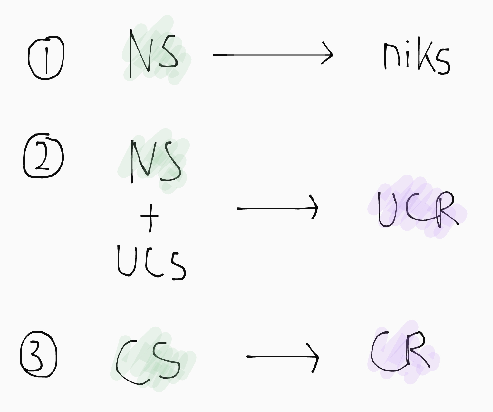
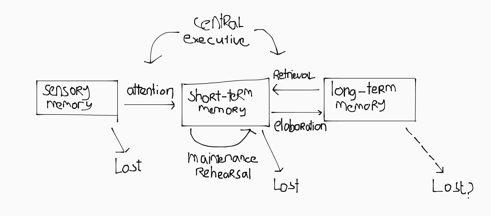

  
Valse dichotomie

  
De lijnen tussen verschillende theorieën en perspectieven zijn soms vaag, en dat is oké. Geen enkele theorie kan leren in alle situaties uitleggen. De combinatie van perspectieven geeft ons juist een compleet beeld. Het is niet nodig om scherp onderscheid te maken.

  
The map of not the territory

  
Alfred Korzybski zei ooit "The map is not the territory": geen enkele menselijke abstractie kan de realiteit volledig en objectief beschrijven, omdat het per definitie versimpelingen van de werkelijkheid zijn, om haar begrijpbaarder te maken. Houdt dit in gedachten tijdens het lezen van de literatuur voor dit vak.

# Behaviourisme

Behaviourisme legt de focus op observeerbaar gedrag. Het is een reactie op instrospectie, een methode die gebruik maakte van diepe zelfreflectie. Dat is volgens behaviouristen subjectief en inaccuraat. Om psychologie een "echte" wetenschap te maken moest het gebruikmaken van systematische empirische observaties, en alleen gedrag kan objectief gemeten worden.

## Principes

- Leren kan alleen wetenschappelijk worden onderzocht door systematische empirische gedragsobservaties.

- Leren wordt gedefineerd als een meetbare gedragsverandering, resulterend uit omgevingsfactoren. ("Leren" en "conditioneren" zijn synoniemen.)

  <!-- ^Deze definitie is mogelijk achterhaald, maar wel toepasbaar voor het uitleggen van **performance** van geleerd gedrag. -->

- **Equipotentiality**: alle diersoorten (inclusief mensen) leren op dezelfde manier. Daarom wordt het woord *organisme* gebruikt.

- **Determinisme**: met complete informatie  over alle omgevingsfactoren van een organisme in het verleden en heden, is het mogelijk het toekomstige gedrag perfect te voorspellen.

- De meest objectieve manier om leren te onderzoeken is door te kijken naar **stimuli** (\\(S\\)) en de daar op volgende **response** (\\(R\\)). (Ookwel \\(\text{S-R}\\) psychologie genoemd).

- Een organisme is een **black box**: interne (mentale) processen kunnen niet objectief gemeten worden en blijven dus buiten beschouwing.

  > Een recente(re) stroming genaamd het **neobehaviourisme** geeft wel een plek aan interne factoren (motivatie, associatie) binnen het organisme (\\(O\\)). (Ookwel \\(\text{S-O-R}\\) psychologie genoemd).

- Een organisme wordt geboren als **blank slate**: er is geen aangeboren aanleg voor bepaald gedrag, alleen biologische instincten of handicaps.

  <!--TODO: "predispositions", koppelen aan dispositions als dat deel geschreven is?-->

- **Parsimony**: de theorie moet zoveel mogelijk situaties uitleggen aan de hand van zo min mogelijk principes.

- Leren is **passief**: lerenden hebben geen invloed op het leren. "Learning happens to the organism, not by the organism."

## Conditioning

### Classical conditioning <small>[Zie ook inleiding onderwijswetenschappen &rarr;](/OWW1/IOWW/Samenvatting.html#leertheoriën)</small>

Bij klassieke conditonering wordt een biologisch reflex op een bestaande stimulus door middel van associatie gekoppeld aan een nieuwe stimulus.

<!--De **neutral stimulus** (NS) wordt door middel van **associatie** gekoppeld aan een **unconditioned stimulus** (UCS) die leidt tot een **unconditioned response** (UCR). Na verloop van tijd zal de neutral stimulus dan veranderen in een **conditioned stimulus** (CS) die tot een **conditioned response** (CR) leidt.-->

<!--

  
Voor conditionering

  <ul>
    <li><strong>Neutral stimulus</strong> (\(NS\)): stimulus die geen reactie uitlokt.</li>
    <li><strong>Unconditioned stimulus</strong> (\(UCS\)): stimulus die vanzelf een reactie uitlokt.</li>
    <li><strong>Unconditioned response</strong> (\(UCR\)): aangeboren reactie op de \(UCS\).</li>
  </ul>

  
Na conditionering

  <ul>
    <li><strong>Conditioned stimulus</strong> (\(CS\)): voormalige \(NS\) die nu een reactie uitlokt.</li>
    <li><strong>Conditioned response</strong> (\(CR\)): aangeleerde reactie op de \(CS\).</li>
  </ul>

-->

<!--

Het gaat vaak best snel, tussen één tot zes pogingen. Het werkt het best als neutrale stimulus vlak voor (~500ms) de ongeconditioneerde stimulus gepresenteerd wordt.

> Het wordt daarom ookwel **signal learning** genoemd, omdat de neutrale stimulus een signaal is dat de komst van de ongeconditioneerde stimulus voorspelt.

De unconditioned en conditioned response kunnen ook van elkaar verschillen. Vaak gaat dit om lengte of intensiteit, maar soms is het ook een andere reactie.

> Dit is bijvoorbeeld het geval bij bepaalde medicijnen. Daar geeft het lichaam een tegengestelde reactie, waarschijnlijk om een evenwicht te houden.

-->

### Operant conditioning

<!--
| classical | operant|
| involuntary | volentary |
-->

# Cognitivisme

## Principes

- Systematische gedragsobservaties kunnen worden gebruikt om conclusies te trekken over cognitieve processen.

- Leren is de vorming van mentale representaties en associaties, en dit hoeft niet altijd tot gedragsverandering te leiden.

- Leerprocessen zijn uniek voor mensen.

- **Sense-making** / **organisatie**: lerenden brengen structuur en betekenis aan in nieuwe informatie, zelfs als die er niet is.

- Leren is **actief**: informatie wordt niet passief geabsorbeerd, maar actief verwerkt.

  
Gestaltpsychologie

  
Gestaltpsychologie (Duits voor "gestructureerd geheel") beschrijft drie principes die beschrijven hoe mensen op gelijke, voorspelbare manier informatie organiseren:

  <ul>
    <li><b>Law of proximity</b>: dingen die dicht bij elkaar staan groeperen.</li>
    <li><b>Law of similarity</b>: dingen die op elkaar lijken groeperen.</li>
    <li><b>Law of closure</b>: dingen die onafgemaakt of incompleet zijn mentaal afmaken.</li>
  </ul>
  <blockquote>
Een ander concept genaamd <b>figure-ground</b> heeft te maken met aandacht: als aandacht gevestigd is op een object ("figure"), verdwijnt de rest in de achtergrond ("ground").
</blockquote>

  
Gedragstaken

  <ul>
    <li>
<b>Serial learning</b>: een lijst aan items onthouden en reproduceren in originele volgorde.
</li>
    <li><b>Paired-associate learning</b>: verschillende items worden aan elkaar gekoppeld, en aan de hand van één van de twee items, moet de andere gereproduceerd worden.</li>
  </ul>
  <blockquote>
Deze taken maken gebruik van korte woorden of lettergrepen, en zijn daarom minder geschikt voor het onderzoeken van complexere cognitieve processen, zoals problem solving of critical thinking.
</blockquote>

## Perspectieven op leren

### Information processing theory

Information processing theory legt uit hoe mensen informatie verwerken, door mensen met computers te vergelijken.

1. **Encoding**: informatie aanpassen zodat deze beter te onthouden is.
2. **Storage**: informatie opslaan in het langetermijngeheugen.
3. **Retrieval**: informatie ophalen uit het langetermijngeheugen.

> Later kwamen er ook andere, niet-computergerelateerde perspectieven bij, maar veel woordenschat is nog wel computergerelateerd.

De theorie heeft limitaties: het ontleedt cognitie in processen, maar kan niet uitleggen hoe die processen samenspelen; het legt uit *hoe* mensen leren, niet *wat* er bij leren gebeurt of ontstaat.

### Constructivisme <small>(Piaget)</small>

Constructivisme stelt dat kennis niet wordt opgenomen of overgedragen door de omgeving, maar door de lerenden zelf wordt geconstrueerd, individueel of samen:

- **Individueel constructivisme**: elke lerenden heeft een eigen constructieproces.
- **Sociaal constructivisme**: meerdere lerenden hebben een gedeeld constructieproces.

De theorie verschuift de nadruk van *hoe* mensen leren, naar *wat* er bij leren gebeurt of ontstaat<!--, namelijk kennisconstructie -->, maar is wel vaag over de exacte cognitieve processen die hierbij betrokken zijn.

<!-- Alleen constructivisme en information processing theory samen kunnen een compleet beeld geven? Beide geven het halve plaatje. -->

> Gestaltpsychologie is lichtelijk constructivistisch: constructie vindt plaats omdat mensen losstaande entiteiten als geheel waarnemen en ontbrekende informatie aanvullen.

<!-- Misschien een passief vs actief of learner-control spectrum diagrammetje maken? En benoemen dat extremen niet altijd ideaal zijn? -->

### Sociocultural theory <small>(Vygotsky)</small> <small>[Zie eigen hoofdstuk &rarr;](#sociocultural-theory)</small>

Sociocultural theory legt de focus op de rol van volwassenen en de cultuur (en de *tools* die ze aanreiken) waarin een kind opgroeit op de ontwikkeling en het leerproces van een kind.

### Contextuele theorieën <small>[Zie eigen hoofdstuk &rarr;](#contextuele-theorieen)</small>

Contextuele theoriën stellen dat leren niet alleen een process is in het hoofd van de lerende, maar ook beïnvloed en ondersteund wordt door de context waarin het leren plaatsvindt.

- **Embodiment**: het brein werkt samen met het lichaam en concrete voorwerpen in de directe omgeving.
- **Distributed cognition**: mensen werken effectiever als ze samenwerken met anderen en/of gebruikmaken van de fysieke omgeving en culturele tools.
- **Systems theory**: context bestaat uit <dfn title="lichaam, directe fysieke omgeving, familiesfeer en vriendenkring, lokale gemeenschappen, landelijke en internationale cultuur">lagen</dfn> die elkaar en de lerende beïnvloeden.

## Perspectieven op geheugen

  
Let op:

  geheugen kan twee dingen betekenen: het proces van informatie opslaan en ophalen<!-- (soort synoniem voor "leren", maar met meer focus op recall)-->, of de plek waar de informatie wordt opgeslagen en opgehaald.

### Dual-storemodel

Het dual-storemodel van geheugen stelt dat het geheugen uit drie componenten bestaat, waarbij informatie wordt opgeslagen op één van twee plekken, afhankelijk van korte of lange termijn:

> Dit is een versimpeld conceptueel model: SM, STM, en LTM zijn geen "plekken" in het brein, en de cognitieve processen die we beschrijven bestaan neurologisch gezien niet.

1. **Sensorisch geheugen**: in het sensorisch geheugen wordt zintuigelijke informatie na binnenkomst voor korte tijd (\\(0\text{-}2\text{s}\\)) vastgehouden, in de modaliteit dat het binnenkwam.

    Het sensorisch geheugen lijkt een grote capaciteit te hebben. De tijd dat informatie wordt vastgehouden is moeilijk te bepalen en verschilt bovendien per modaliteit.

    <!-- Visuele input wordt kort (\\(< 1\text{s}\\)) volledig vastgehouden, en deels langer (tot \\(2\text{s}\\)). Auditieve input wordt langer (\\(2\text{s}+\\)) vastgehouden, dit is waarschijnlijk omdat spraak sequentieel verwerkt wordt, en daarvoor context van de vorige woorden nodig is.-->

    Informatie verdwijnt uit het sensorisch geheugen door twee processen: **interference** van nieuwe zintuigelijke informatie, en **decay** van vastgehouden informatie.

2. **Kortetermijngeheugen**: in het kortetermijn- of werkgeheugen wordt informatie voor korte tijd (\\(< 30\text{s}\\)) bewust verwerkt, in verschillende modaliteiten:

    - **Visuospatial scratchpad**: manipulatie van visuele en ruimtelijke informatie.
    - **Phonological loop**: auditieve informatie vasthouden door middel van herhaling.
    - **Episodic buffer**: begrip en bewustzijn van de situatie waarin je je bevindt.

    <!-- Er is een maximum hoeveelheid elementen dat tegelijkertijd in de phological loop actief gehouden kan worden. Dit is de hoeveelheid elementen waarbij de eerste nét niet uit het werkgeheugen verdwijnt door decay of interference. -->

    <!-- De lengte van de woorden lijkt ook uit te maken. Als woorden langer zijn kunnen minder woorden vastgehouden worden. Dit heet het **word length effect**. -->

    De capaciteit van het werkgeheugen is zeer gelimiteerd (<dfn title="Er is geen consensus over deze hoeveelheid. Er zijn ook onderzoekers die zeggen dat maar 3-5 betekenisvolle items vastgehouden kunnen worden">\\(5\text{-}9\\) items</dfn>). De hoeveelheid items kan niet verhoogd worden, maar de hoeveelheid informatie wel, door informatie te combineren. Dit noemen we **chunking**.

    Verwerking wordt aangestuurd door de <dfn title="aandacht richten, overzicht houden, conclusies trekken, beslissingen maken, gedrag aansturen en inhiberen">executieve functies</dfn>, door een subcomponent van het werkgeheugen genaamd de **central executive**. Er zijn leeftijdgerelateerde verschillen en individuele verschillen in effortful control.

    Informatie komt in het kortetermijngeheugen door middel van **aandacht**: gerichte cognitieve verwerking van bepaalde aspecten van de omgeving, die zintuigelijke input prioriteert zodat het werkgeheugen niet overbelast raakt.

    Aandacht kan automatisch getrokken worden door bepaalde facturen, of bewust gestuurd worden, en kan gericht zijn zonder dat je jezelf fysiek hoeft te oriënteren (eg. via gehoor).

    <!-- Verschillende mensen besteden aandacht aan verschillende aspecten van een stimulus. Dit verschil is vooral bij complexe stimuli groot. -->

    Dezelfde processen van **interference** en **decay** zorgen er weer voor dat informatie weer uit het werkgeheugen verdwijnt.

3. **Langetermijngeheugen**: in het langetermijngeheugen wordt informatie voor lange tijd opgeslagen. De capaciteit van het langetermijngeheugen is zover we weten oneindig.

    > We weten niet of informatie permanent wordt opgeslagen. Het kan zijn dat het na een tijd verdwijnt, het kan ook zijn dat we het simpelweg niet meer kunnen ophalen.

    Opslag in het langetermijngeheugen gebeurt door **elaboratie**: informatie diep verwerken, bijvoorbeeld door het te relateren aan bestaande kennis. Hierbij is de gelimiteerde capaciteit van het werkgeheugen een "bottleneck", waar veel informatie verloren gaat.

    Informatie kan op verschillende manieren worden opgeslagen, afhankelijk van hoe het is encoded in het werkgeheugen.

    - **Declaratief geheugen** <small>(expliciet geheugen)</small>:

      - **Episodisch geheugen**: herinneringen van persoonlijke ervaringen of gebeurtenissen.

      - **Semantisch geheugen**: algemene feitenkennis, taal, conceptuele kennis

    - **Non-declaratief geheugen** <small>(impliciet geheugen)</small>

      - **Procedureel geheugen**: procedures voor fysieke en cognitieve vaardigheden.

      - **Priming**

      - **Conditionering**

      - **Non-associatief**

  

    
Executieve functies

    <ul>
      <li>
        
<strong>Organiseren</strong>: effectieve capaciteit van het werkgeheugen vergroten door informatie te groeperen (eg. chunking) of te relateren aan voorkennis.

      </li>
      <li>
        
<strong>Retrieval</strong>: informatie uit het kortetermijngeheugen ophalen. Dit gebeurt door alle items sequentieel te scannen.

      </li>
      <li>
        
<strong>Maintenance rehearsal</strong>: informatie herhalen zodat het vastgehouden blijft in het werkgeheugen en niet verdwijnt door interference of decay.

      </li>
    </ul>
  

  

    
Andere soorten geheugen

    <ul>
      <li>
        
<strong>Conditioneel geheugen</strong>: procedureel geheugen met IF-THEN regels.

      </li>
      <li>
        
<strong>Conceptueel geheugen</strong>: de combinatie van declaratief en non-declaratief geheugen, dat ons een compleet beeld van een situatie geeft.

      </li>
    </ul>
  

  

    
Factoren die aandacht trekken

    <ul>
      <li>Grote, felgekleurde, luide of bewegende objecten.</li>
      <li>Nieuwe, ongewone, of afwijkende situaties.</li>
      <li>Sociale cues, zoals waar anderen naar kijken of op reageren.</li>
      <li>Sterke emotionele associaties.</li>
    </ul>
    
Deze factoren trekken aandacht, maar houden die niet altijd vast. Daarvoor is persoonlijk belang vooral van belang <small>(haha ik ben zo grappig)</small>.

  

<!-- argumentatie van pagina 184-186 begrijpen en samenvatten -->

### Levels of processing

Het levels-of-processingmodel van geheugen stelt dat geheugen het resultaat is van verwerking door een **central processor**, waarbij de mate van verwerking bepaalt hoe goed en hoe lang iets wordt opgeslagen:

1. **Geen verwerking**: alleen een korte indruk, vergelijkbaar met sensorisch geheugen van dual-storemode.

2. **Oppervlakkige verwerking**: alleen aandacht voor <dfn title="kleur, vorm, helderheid, grootte, klank, geur etc.">oppervlaktekenmerken</dfn>, vergelijkbaar met werkgeheugen van dual-storemodel.

3. **Diepe verwerking**: interpretatie en koppeling aan voorkennis, vergelijkbaar met langetermijngeheugen van dual-storemodel.

> Mensen met de intentie om te leren ('intention to learn') verwerken informatie dieper en leren daardoor meer. Maar mensen die informatie diep verwerken zonder dat ze actief proberen te leren, leren het even goed ('incidental learning').

  
Kritiek op levels-of-processingmodel

  <ul>
    <li>"Niveau" van verwerking en "diepgang" zijn vaag en moeilijk te definiëren.</li>
    <li>Informatie die vaak herhaald wordt, wordt beter geleerd, ongeacht diepgang.</li>
    <li>In sommige gevallen leidt oppervlakkige verwerking (eg. rijmen) tot betere recall dan diepe verwerking (eg. relateren aan voorkennis).</li>
  </ul>

### Activation

Het activatiemodel van geheugen stelt dat de verschillende soorten geheugens activatiestaten zijn van één geheugen, waarin informatie actief of inactief kan zijn.

Aan actieve informatie wordt aandacht besteedt en deze wordt bewust verwerkt. Dit kan nieuwe informatie zijn of voorkennis. Als aandacht verschuift, wordt andere informatie actief, en wordt de voorheen geactiveerde informatie langzaam inactief. Het grootste deel van de informatie in ons geheugen is inactief, en we zijn ons hier niet van bewust.

<!--
> In dit model zijn werkgeheugen en langetermijngeheugen simpelweg activatietoestanden: actieve informatie is "in werkgeheugen", en inactieve informatie is "in langetermijn".
-->

Als informatie geactiveerd wordt, activeert dit ook automatisch geassocieerde informatie, waardoor deze makkelijker op te halen wordt. Dit heet **priming**.

## Perspectieven op kennis

### Propositional networks

Informatie wordt opgeslagen als **proposities** in een **propositioneel netwerk**. Een propositie is kennis over objecten en personen, en de relaties daartussen.

Leren (en dan specifiek 'meaningful learning') kan worden beschreven als het verbinden van nieuwe proposities met bestaande proposities in dit netwerk.

  
Kritiek propositional networks

  <ul>
    <li>Proposities zijn nogal zwart-wit: ze zijn waar of niet waar. Daarmee kan je niet beschrijven hoe complexe interpretaties of emotionele reacties worden opgeslagen.</li>
  </ul>

### Parallel distributed processing

Informatie wordt verspreid ('distributed') opgeslagen over *nodes* op verschillende plekken in het brein. Als informatie wordt opgehaald worden deze nodes gelijktijdig ('parallel') verwerkt.

Leren kan worden beschreven als een proces van versterken van associaties tussen nodes.

<!-- Deze theorie kan uitleggen waarom we incomplete informatie zo makkelijk mentaal aanvullen ('law of closure'): als genoeg nodes activeren, worden gerelateerde nodes ook makkelijker actief. -->

> Deze theorie komt voort uit neurologische bevindingen dat bij het ophalen van informatie veel verschillende hersengebieden actief worden. Informatie wordt dus ogenschijnlijk niet op één plek opgeslagen.

  
Kritiek parallel distributed processing

  <ul>
    <li>Het model geeft geen duidelijkheid over situaties waarin we snel leren, analogiën trekken tussen ongerelateerde situaties, of overtuigd worden van argumentatie. <!-- maar waarom zouden nodes niet *snel* geassocieerd kunnen worden? --></li>
    <li>Sterk geautomatiseerde cognitieve taken lijken wel gelocaliseerd te zijn in het brein.</li>
  </ul>

## Soorten kennis

### Concepten

Een concept is een mentale groepering van vergelijkbare objecten of gebeurtenissen.

- **Concrete objecten** hebben fysieke gelijkenissen die makkelijk te observeren zijn.
- **Abstracte concepten** hebben gelijkenissen die moeilijker te observeren zijn.

Een **positieve instance** is een voorbeeld van een concept, een **negatieve instance** juist niet.

- **Ondergeneralisatie** is een onvermogen om alle positieve instances te identificeren.
- **Overgeneralisatie** is een onvermogen om alle negatieve instances weg te filteren.

Een positieve instance wordt gekenmerkt door bepaalde *features*:

- **Defining features** zijn essentieel voor het concept en komen in *alle* instances voor.
- **Correlationele features** zijn niet essentieel, maar komen wel in *veel* instances voor.
- **Irrelevante features** zijn ongerelateerd, maar komen wel in *sommige* instances voor.

> Concepten kunnen worden geleerd door passieve opbouw van associaties, of door actief de defining features van een concept te leren.

Sommige concepten hebben een typisch voorbeeld, genaamd een **prototype**. Andere concepten hebben niet één specifiek voorbeeld, daarbij worden verschillende **exemplars** gebruikt.

> Lerenden maken initieel veel gebruik van prototypes en exemplars; later ontwikkelen zij een meer abstract begrip, soms met een formele definitie.

  
Factoren die het leren van concepten bevorderen

  <ul>
    <li>
Defining features zo duidelijk mogelijk maken: highlight de defining features, en downplay de correlationele en irrelevante features.
</li>
    <li>
Definities die defining features benoemen en het concept beschrijven in termen van concepten waar lerenden al voorkennis van hebben.
</li>
    <li>
Veel en gevarieerde positieve instances geven, eerst duidelijke voorbeelden met zo min mogelijk irrelevante features, later steeds vagere voorbeelden, om ondergeneralisatie te voorkomen.
</li>
    <li>
Veel en gevarieerde negatieve instances geven, vooral bijna-wel-voorbeelden zijn belangrijk, om overgeneralisatie te voorkomen.
</li>
    <li>
Positieve en negatieve instances moeten tegelijk worden gegeven, in plaats van sequentieel.
</li>
  </ul>

### Schema's en scripts

Een schema is een groepering van gerelateerde ideeën en concepten, gekoppeld aan een object of gebeurtenis. Schema's gekoppeld aan een gebeurtenis noemen we soms een script.

> Het is onduidelijk wat schema's precies *zijn*, en de cognitieve processen voor het vormen van schema's zijn ook onduidelijk.
>
> a.k.a. je kan hier dus echt net niks mee.. maar hey, das like 90% van deze studie right?

### Personal theories

Lerenden vormen persoonlijke <dfn title="'coherente overtuigingen die oorzaak-gevolgrelaties bevatten'">theorieën</dfn> over o.a. de fysieke wereld, sociale relaties, biologie, politiek, cognitie en de mens.

Theory theory beschrijft hoe mensen deze persoonlijke theorieën vormen. <!-- Is dat alles dat we weten over theory theory? -->

<!--
> Jonge kinderen maken onderscheid tussen kunstmatige objecten en biologische entiteiten. Kunstmatige objecten worden gedefinieerd door hun functie, biologische entiteiten door hun oorsprong.
-->

> Het is onmogelijk om te weten wat "echt" of "waar" is. Alle kennis over de wereld is geconstrueerd; het zijn modellen om de werkelijkheid te duiden. Echter, sommige modellen zijn *nuttiger* dan andere, omdat ze de werkelijkheid beter beschrijven en voorspellen.

### Wereldbeelden

Persoonlijke theorieën richten zich op één domein of verschijnsel. Een wereldbeeld is breder: een verzameling overtuigingen en veronderstellingen over de werkelijkheid in het algemeen.

Wereldbeelden zijn deels cultureel bepaald en zijn meestal impliciete kennis, waar we ons niet altijd bewust van zijn.

  
Voorbeelden van wereldbeelden

  <ul>
    <li>
Leven en universum zijn willekeurig ontstaan of door een hogere macht.
</li>
    <li>
Objecten hebben bewustzijn of niet.
</li>
    <li>
Mensen zijn onderdanig aan de natuur, leven in samenspel met de natuur, of staan boven de natuur.
</li>
    <li>
Succes en falen zijn resultaat van acties, een hogere macht, het lot, of willekeur.
</li>
    <li>
Alle mensen hebben evenveel recht op middelen, of sommige mensen hebben meer recht dan andere.
</li>
    <li>
Mensen zijn inherent goed, of inherent slecht, of geen van beide.
</li>
  </ul>

### Epistemic beliefs

## Conceptual change

Het rechtzetten van een misconceptie is makkelijk als het simpele feitenkennis betreft. Maar soms is een misconceptie onderdeel van een persoonlijke theorie, wereldbeeld, of epistemic belief, die dan aangepast of vervangen dient te worden. Dit noemen we **conceptual change**.

> Dit is verwarrende benaming: het draait niet zo zeer om simpele concepten, maar om het geheel van samenhangende overtuigingen van een theorie, wereldbeeld of epistemic belief.

Conceptual change is moeilijk. Mensen houden vaak lang vast aan misconcepties, zelfs na expliciete instructie en tegenbewijs.

  
Redenen dat mensen vasthouden aan misconcepties

  <ul>
    <li>
      
Nieuwe informatie wordt geinterpreteerd zodat deze overeenkomt met bestaande overtuigingen.

    </li>
    <li>
      
Inconsistentie tussen nieuwe informatie en bestaande overtuigingen wordt niet herkend, waardoor zowel correcte en foute representatie in het geheugen wordt opgeslagen.

    </li>
    <li>
      
Confirmation bias zorgt ervoor dat gewenste informatie wordt aangenomen en tegenstrijdig bewijs wordt genegeerd.

    </li>
    <li>
      
Bestaande overtuigingen zijn vaak over consistent met ervaringen in het allerdaagse leven.

    </li>
    <li>
      
Bestaande overtuigingen zijn vaak diep geïntegreerd met andere overtuigingen.

    </li>
    <li>
      
Bestaande overtuigingen hebben vaak persoonlijke of emotionele waarde (cultuur, religie, identiteit).

    </li>
    <li>
      
Bestaande overtuigingen worden ondersteund en aangemoedigd door de sociale omgeving.

    </li>
  </ul>

  
Factoren die conceptual change bevorderen

  <ul>
    <li>
      
Vooraf misconcepties vaststellen zodat deze effectiever geadresseerd kunnen worden.

    </li>
    <li>
      
Bestaande overtuigingen kunnen een kern van waarheid bevatten waarom voortgebouwd kan worden.

    </li>
    <!-- de rest ook nog... -->
  </ul>

<!--
# Social cognitive theory

Social cognitive theory is een combinatie van behaviourisme en cognitivisme, met een focus op leren door observatie en modeling.

> Het is ontstaan als *social learning theory*, op basis van behaviouristische principes. Door de toevoeging van steeds meer cognitieve concepten is het uiteindelijk uitgegroeid tot *social cognitive theory*.

## Principes

- Leren door observatie van het gedrag van anderen, en de consequenties daarvan.
- Leren is mogelijk zonder gedragsverandering.
- **Attention** en **retention** spelen een belangrijke rol in leren.
- Leren is **actief** en lerenden hebben **personal agency**: invloed op zichzelf en de omgeving.

<!--
| behaviourisme | sct |
| trial-and-error | modeling |

as maken met passief vs actief of hoeveelheid controle die de lerende heeft?
-->
