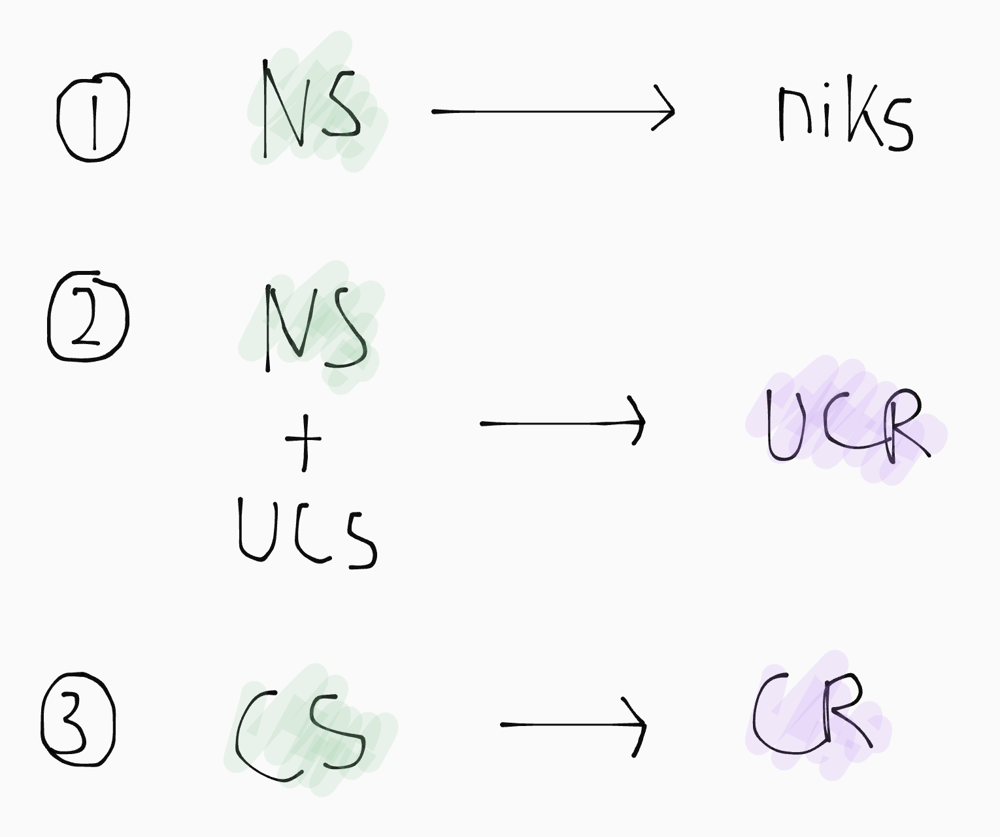
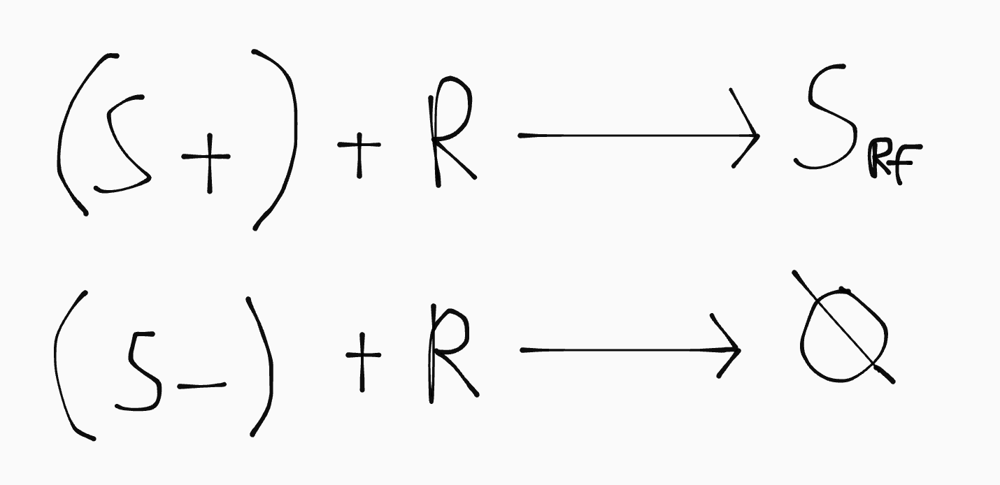
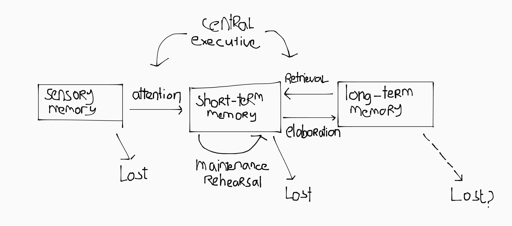
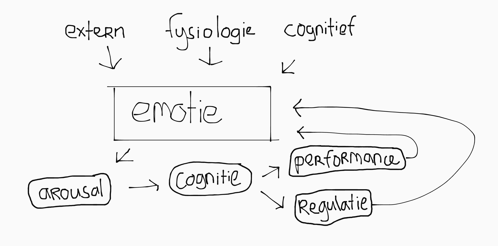

<!--

  
Valse dichotomie

  
De lijnen tussen verschillende theorieën en perspectieven zijn soms vaag, en dat is oké. Geen enkele theorie kan leren in alle situaties uitleggen. De combinatie van perspectieven geeft ons juist een compleet beeld. Het is niet nodig om scherp onderscheid te maken.

  
The map of not the territory

  
Alfred Korzybski zei ooit "The map is not the territory": geen enkele menselijke abstractie kan de realiteit volledig en objectief beschrijven, omdat het per definitie versimpelingen van de werkelijkheid zijn, om haar begrijpbaarder te maken. Houdt dit in gedachten tijdens het lezen van de literatuur voor dit vak.

-->

# Behaviourisme

Behaviourisme legt de focus op observeerbaar gedrag. Het is een reactie op instrospectie, een methode die gebruik maakte van diepe zelfreflectie. Dat is volgens behaviouristen subjectief en inaccuraat. Om psychologie een "echte" wetenschap te maken moest het gebruikmaken van systematische empirische observaties, en alleen gedrag kan objectief gemeten worden.

## Principes

- Leren kan alleen wetenschappelijk worden onderzocht door systematische empirische gedragsobservaties.

- Leren wordt gedefineerd als een meetbare gedragsverandering, resulterend uit omgevingsfactoren. ("Leren" en "conditioneren" zijn synoniemen.)

  <!-- ^Deze definitie is mogelijk achterhaald, maar wel toepasbaar voor het uitleggen van **performance** van geleerd gedrag. -->

- **Equipotentiality**: alle diersoorten (inclusief mensen) leren op dezelfde manier. Daarom wordt het woord "organisme" gebruikt.

- **Determinisme**: met complete informatie  over alle omgevingsfactoren van een organisme in het verleden en heden, is het mogelijk het toekomstige gedrag perfect te voorspellen.

- De meest objectieve manier om leren te onderzoeken is door te kijken naar **stimuli** (\\(S\\)) en de daar op volgende **response** (\\(R\\)). (Ookwel \\(\text{S-R}\\) psychologie genoemd).

- Een organisme is een **black box**: interne (mentale) processen kunnen niet objectief gemeten worden (<dfn title="Tenminste, niet toen, denk ik? Lijkt me dat het tegenwoordig wel zou kunnen bijv. fMRI scans en dergelijke?">?</dfn>) met en blijven dus buiten beschouwing.

  > Een recente(re) stroming genaamd het **neobehaviourisme** geeft wel een plek aan interne factoren (motivatie, associatie) binnen het organisme (\\(O\\)). (Ookwel \\(\text{S-O-R}\\) psychologie genoemd).

- Een organisme wordt geboren als **blank slate**: er is geen aangeboren aanleg voor bepaald gedrag, alleen biologische instincten of handicaps.

  <!--TODO: "predispositions", koppelen aan dispositions als dat deel geschreven is?-->

- **Parsimony**: de theorie moet zoveel mogelijk situaties uitleggen aan de hand van zo min mogelijk principes.

- Leren is **passief**: lerenden hebben geen invloed op het leren. "Learning happens to the organism, not by the organism."

## Classical conditioning

Bij klassieke conditonering wordt een biologisch reflex op een bestaande stimulus door middel van associatie gekoppeld aan een nieuwe stimulus.

<!--De **neutral stimulus** (NS) wordt door middel van **associatie** gekoppeld aan een **unconditioned stimulus** (UCS) die leidt tot een **unconditioned response** (UCR). Na verloop van tijd zal de neutral stimulus dan veranderen in een **conditioned stimulus** (CS) die tot een **conditioned response** (CR) leidt.-->

<!--

  
Voor conditionering

  <ul>
    <li><strong>Neutral stimulus</strong> (\(NS\)): stimulus die geen reactie uitlokt.</li>
    <li><strong>Unconditioned stimulus</strong> (\(UCS\)): stimulus die vanzelf een reactie uitlokt.</li>
    <li><strong>Unconditioned response</strong> (\(UCR\)): aangeboren reactie op de \(UCS\).</li>
  </ul>

  
Na conditionering

  <ul>
    <li><strong>Conditioned stimulus</strong> (\(CS\)): voormalige \(NS\) die nu een reactie uitlokt.</li>
    <li><strong>Conditioned response</strong> (\(CR\)): aangeleerde reactie op de \(CS\).</li>
  </ul>

-->

<!-- Het gaat vaak best snel, tussen één tot zes pogingen. -->

Niet alleen nabijheid in tijd ('**contiguity**') is belangrijk, maar ook voorspelbaarheid ('**contingency**'): de neutrale stimulus moet een signaal zijn dat de komst van de ongeconditioneerde stimulus voorspelt. Het wordt daarom ookwel **signal learning** genoemd.

De unconditioned en conditioned response kunnen ook van elkaar verschillen. Vaak gaat dit om lengte of intensiteit, maar soms is het ook een andere reactie.

> Dit is bijvoorbeeld het geval bij bepaalde medicijnen. Daar geeft het lichaam een tegengestelde reactie, waarschijnlijk om een evenwicht te houden.

### Extinctie

Als de geconditioneerde stimulus te vaak wordt gepresenteerd zonder de ongeconditioneerde stimulus, is het geen goed signaal meer, en zal dus de geconditioneerde response op den duur niet meer optreden. Dit heet **extinctie**.

> In het geval van angst gebeurt dit vaak niet, omdat mensen de geconditioneerde stimulus vaak actief uit de weg gaan.

> Soms vindt extinctie plaats in één specifieke context, en blijft de geconditioneerde response in andere contexten wel intact.

Soms komt de geconditioneerde response terug als de extinctie gevolgd wordt door een rustperiode. Dit noemen we **spontanious recovery**. Hierna is de geconditioneerde response vaak wel zwakker, en de kans op extinctie groter.

### Generalisatie

Vaak komt de geconditioneerde response ook voor bij stimuli die  lijken op de geconditioneerde stimulus. Dit noemen we **generalisatie**.

Dit kan worden opgelost met **stimulus discriminatie**. De andere stimulus (\\(\text{CS}-\\)) wordt zonder de ongeconditioneerde stimulus gepresenteerd, en de geconditioneerde stimulus (\\(\text{CS}+\\)) met, waardoor de geconditioneerde response verdwijnt door middel van extinctie.

### Higher-order conditioning

In **higher-order conditioning** wordt de geconditioneerde stimulus (\\(\text{CS}\_n\\)) gebruikt in de rol van de ongeconditioneerde stimulus, om een nieuwe geconditioneerde stimulus (\\(\text{CS}\_{n+1}\\)) te creëren.

### Counter-conditioning

Voor het afleren van een geconditioneerde response is alleen extinctie niet genoeg, omdat spontanious recovery mogelijk is. In plaats daarvan moet de associatie tussen stimulus en response worden vervangen met een nieuwe associatie. Dit heet **counter-conditioning**.

    
Voorwaarden voor counter-conditioning

    <ul>
      <li>De vervangende response moet <dfn title="In het geval van emoties betekent dit de tegenovergestelde emotie.">incompatible</dfn> zijn met de oude response.</li>
      <li>De vervangende response moet sterker zijn dan de bestaande response.</li>
      <li>De nieuwe ongeconditioneerde stimulus moet deze nieuwe response oproepen.</li>
      <li>De nieuwe ongeconditioneerde stimulus wordt gepresenteerd, en de geconditioneerde stimulus wordt geleidelijk toegevoegd.</li>
    </ul>

    
Let op:

    Counter-conditioning met <em>afbeeldingen</em> van een stimulus is ineffectief tegen de daadwerkelijke stimulus.

## Operant conditioning

Bij operante conditionering wordt gedrag bekrachtigd ('reinforcement') waardoor het in frequentie toeneemt. Dit is gebaseerd op onderzoek van eerst Thorndike en later Skinner.

    
Thorndikes law of effect

    Responses to a situation followed by satisfaction are strenghthened; responses that are followed by discomfort are weakened.

<!--
> Punishment is minder effectief dan reinforcement, en heeft een indirect effect: discomfort maakt het ongewenste gedrag moeilijker.
-->

<!--
> We noemen het een "reinforcer" en geen "reward", omdat dat het anders niet objectief zou zijn.
-->

<!--

    
Transitutional generality

    
Operant conditioneren wordt gedefinieerd als het toenemen van frequentie van gedrag door middel van reinforcers.

    
Een <b>reinforcer</b> wordt gedefineerd als een stimulus die de frequentie van het gedrag die het volgt verhoogt.

    
Dit is een circulaire definitie. Daarom wordt toegevoegd dat reinforcers de frequentie van gedrag over het algemeen, in verschillende situaties, verhogen. Door deze <b>transitional generality</b> wordt de circulaire definitie verbroken.

    
Denk er niet te hard over na, anders explodeert je hoofd.

-->

De reinforcer (\\(\text{S}_{Rf}\\)) komt direct na de response (\\(\text{R}\\)), niet later ('delayed reinforcement'), en alleen bij gewenste de response ('contingency').

    
Verschillen tussen classical en operant conditioning

    <table style="margin-top: 0.75em"><thead>
      <tr>
        <th>Classical conditioning</th>
        <th>Operant conditioning</th>
      </tr>
    </thead>
    <tbody>
      <tr>
        <td>\(\text{CS}\) voor de response</td>
        <td>\(\text{S}_{Rf}\) na de response</td>
      </tr>
      <tr>
        <td>Associatie: \(\text{CS} \to \text{CR}\)</td>
        <td>Associatie: \(\text{R} \to \text{S}_{Rf}\)</td>
      </tr>
      <tr>
        <td>Involuntary (ellicited)</td>
        <td>Voluntary (emitted)</td>
      </tr>
    </tbody>
    </table>

### Reinforcers

Een reinforcer kan **positief** of **negatief** zijn. Bij postive reinforcement wordt er een gewenste stimulus toegevoegd. Bij negative reinforcement wordt een ongewenste stimulus weggehaald.

Er zijn twee soorten reinforcers:

- **Primaire reinforcers**: het vervullen van een biologische behoefte of verlangen. <small>(eten, water, warmte, sociale binding, seks)</small>
- **Secondaire reinforcers**: een signaal voor een latere primaire reinforcer. <small>(complimenten, goede cijfers, geld)</small>

> Een secondaire reinforcer wordt via klassieke conditionering geassocieerd met een primaire reinforcer. We noemen het daarom ookwel een **conditioned reinforcer**.

De effectiviteit van een reinforcer is afhankelijk van de omgeving.

    
Voorbeelden van positieve reinforcers

    <ul>
      <li>
        
<strong>Social reinforcers</strong>: positieve sociale interactie (eg. praise, lachen, aanmoedigen).

      </li>
      <li>
        
<strong>Activity reinforcers</strong>: mogelijkheid om een bepaalde activiteit te mogen doen.

      </li>
      <li>
        
<strong>Token reinforcers</strong>: besteedbare punten, gebruikt in <strong>token economies</strong>.

      </li>
      <li>
        
<strong>Material or tangible reinforcers</strong>: fysieke objecten (eg. speelgoed). Zeer effectief maar ook afleidend, en zouden daarom alleen als laatste redmiddel gebruikt moeten worden.

      </li>
    </ul>

<!--

    
Premack principle of activity reinforcement

   When an oppurtunity to make a normally high-frequency [aka enjoyable] response is contingent on first making a normally low-frequency [aka unenjoyable] response, the high-frequency response will increase the frequency of the low-frequency response.

-->

    
Voorbeelden van negatieve reinforcers

    <ul>
        <li>
Het wegnemen van schuldgevoel of anxiety is een zeer sterke negatieve reinforcer, en verklaart veel van het escape-gedrag dat mensen vertonen.
</li>
    </ul>

    
Reinforcers die niet goed binnen behaviourisme passen

    <ul>
      <li>
        
<strong>Feedback</strong>: zowel positieve als negatieve feedback zorgt voor toename van gewenst gedrag. Het lijkt <em>bijna</em> alsof lerenden nadenken (gasp!) over de feedback!

      </li>
      <li>
        
<strong>Intrinsieke reinforcers</strong>: fijne gevoelens zoals trots of opluchting. Dit zijn mentale concepten, en dat is een big no no!

      </li>
    </ul>

### Punishment

### Bijgeloof

Willekeurige reinforcement leidt tot bijgeloof, omdat het onduidelijk is welke response (als überhaupt een response) de oorzaak is voor de reinforcement.

### Shaping

Door middel van **shaping** is het mogelijk gewenst gedrag aan te leren dat nog niet wordt vertoond, door gedrag te reinforcen dat steeds dichter bij het gewenste gedrag komt.

### Chaining

Door middel van **chaining** kan een specifieke sequentie van gedrag worden reinforced.

### Extinctie

Bij **extinctie** neemt gewenst gedrag in frequentie af omdat het niet langer reinforced wordt. Soms neemt het gedrag eerst kort in frequentie toe, vaak met meer variatie. Dit noemen we een **extinction burst**.

- Bij **continious reinforcement** wordt altijd reinforced. Hiermee is conditioneren snel, maar de kans op extinctie groter.

- Bij **intermittent reinforcement** wordt soms reinforced. Daarmee is conditioneren minder snel, maar de kans op extinctie kleiner.

De beste resultaten worden behaald door continuous reinforcement te gebruiken voor het opbouwen van gedrag, en intermittent reinforcement voor het behouden van gedrag.

### Schedules

Het **reinforcement schedule** bepaalt hoe vaak gedrag wordt reinforced:

- **Fixed-ratio** (FR): bij elke \\(n\\)de response.
- **Variable-ratio** (VR): bij elke \\(n\\)de response gemiddeld.
- **Fixed-interval** (FI): bij eerste response na \\(n\\) tijd.
- **Variable-interval** (VI): bij eerste response na \\(n\\) tijd gemiddeld.
- **Differential rate of high responding** (DHR): bij \\(x\\) of meer responses in \\(n\\) tijd.
- **Differential rate of low responding** (DLR): bij \\(x\\) of minder responses in \\(n\\) tijd.

Een DLR-schedule is lastig omdat het inhoudt voorheen reinforced gedrag *niet* te vertonen.

### Antecedent stimulus

**Antecedent stimuli** en **antecedent responses** gaan vooraf aan gedrag en beïnvloeden de kans dat bepaald gedrag optreedt.

Een **distriminative stimulus** (\\(\text{S}+\\)) is een antecedent stimulus die als signaal dient voor een grotere of kleiner kans op reinforcement. Als een organisme hierdoor ander gedrag vertoont, zeggen we dat het onder **stimulus control** is. Het presenteren van een distriminative stimulus noemen we **prompting** of **cueing**.

> Soms kan een gehele situatie ('**setting event**') als distriminative stimulus dienen.

Voor antecedent stimuli kan net als bij klassieke conditionering **generalisatie** optreden: het organisme past gedrag aan bij vergelijkbare stimuli.

In operante conditionering, houdt **stimulus discriminatie** in dat gedrag alleen wordt reinforced bij een bepaalde stimulus (\\(\text{S}+\\)) maar niet bij andere stimuli (\\(\text{S}-\\)).

Bij **behavioural momentum** is de kans op een response groter als vergelijkbaar gedrag al wordt vertoond.

### Avoidance learning

**Avoidance learning** houdt in dat mensen leren weg te blijven bij **aversive stimuli** (eg. pijn, anxiety, frustratie), als die vooraf gegaan worden door een **pre-aversive stimulus** als signal.

- **Active avoidance behaviour**: actief actie ondernemen om de aversive stimulus te ontlopen.
- ⁣**Passief avoidance behaviour**: juist iets niet doen om daarmee de aversive stimulus te ontlopen.

> Avoidance behaviour is moeilijk af te leren, omdat de extinctie van de pre-aversive stimulus niet gebeurt, ook niet als de aversive stimuli niet meer aversive is, omdat organismes de aversive stimulus actief ontlopen.

<!-- wat zijn nou de verschillen tussen antecedent stimuli en classic conditioning?? -->

<!-- punishment -->

# Cognitivisme

## Principes

- Systematische gedragsobservaties kunnen worden gebruikt om conclusies te trekken over cognitieve processen.

- Leren is de vorming van mentale representaties en associaties, en dit hoeft niet altijd tot gedragsverandering te leiden.

- Leerprocessen zijn uniek voor mensen.

- **Sense-making** / **organisatie**: lerenden brengen structuur en betekenis aan in nieuwe informatie, zelfs als die er niet is.

- Leren is **actief**: informatie wordt niet passief geabsorbeerd, maar actief verwerkt.

  
Gestaltpsychologie

  
Gestaltpsychologie (Duits voor "gestructureerd geheel") beschrijft drie principes die beschrijven hoe mensen op gelijke, voorspelbare manier informatie organiseren:

  <ul>
    <li><b>Law of proximity</b>: dingen die dicht bij elkaar staan groeperen.</li>
    <li><b>Law of similarity</b>: dingen die op elkaar lijken groeperen.</li>
    <li><b>Law of closure</b>: dingen die onafgemaakt of incompleet zijn mentaal afmaken.</li>
  </ul>
  <blockquote>
Een ander concept genaamd <b>figure-ground</b> heeft te maken met aandacht: als aandacht gevestigd is op een object ("figure"), verdwijnt de rest in de achtergrond ("ground").
</blockquote>

  
Gedragstaken

  <ul>
    <li>
<b>Serial learning</b>: een lijst aan items onthouden en reproduceren in originele volgorde.
</li>
    <li><b>Paired-associate learning</b>: verschillende items worden aan elkaar gekoppeld, en aan de hand van één van de twee items, moet de andere gereproduceerd worden.</li>
  </ul>
  <blockquote>
Deze taken maken gebruik van korte woorden of lettergrepen, en zijn daarom minder geschikt voor het onderzoeken van complexere cognitieve processen, zoals problem solving of critical thinking.
</blockquote>

## Perspectieven op leren

### Information processing theory

Information processing theory legt uit hoe mensen informatie verwerken, door mensen met computers te vergelijken.

1. **Encoding**: informatie aanpassen zodat deze beter te onthouden is.
2. **Storage**: informatie opslaan in het langetermijngeheugen.
3. **Retrieval**: informatie ophalen uit het langetermijngeheugen.

> Later kwamen er ook andere, niet-computergerelateerde perspectieven bij, maar veel woordenschat is nog wel computergerelateerd.

De theorie heeft limitaties: het ontleedt cognitie in processen, maar kan niet uitleggen hoe die processen samenspelen; het legt uit *hoe* mensen leren, niet *wat* er bij leren gebeurt of ontstaat.

### Constructivisme

Constructivisme stelt dat kennis niet wordt opgenomen of overgedragen door de omgeving, maar door de lerenden zelf wordt geconstrueerd, individueel of samen:

- **Individueel constructivisme**: elke lerenden heeft een eigen constructieproces.
- **Sociaal constructivisme**: meerdere lerenden hebben een gedeeld constructieproces.

De theorie verschuift de nadruk van *hoe* mensen leren, naar *wat* er bij leren gebeurt of ontstaat<!--, namelijk kennisconstructie -->, maar is wel vaag over de exacte cognitieve processen die hierbij betrokken zijn.

<!-- Alleen constructivisme en information processing theory samen kunnen een compleet beeld geven? Beide geven het halve plaatje. -->

> Gestaltpsychologie is lichtelijk constructivistisch: constructie vindt plaats omdat mensen losstaande entiteiten als geheel waarnemen en ontbrekende informatie aanvullen.

<!-- Misschien een passief vs actief of learner-control spectrum diagrammetje maken? En benoemen dat extremen niet altijd ideaal zijn? -->

<!-- specifiek individueel constructivisme is piaget -->

<!-- constructivisme + sociocultural + contextual = cognitive developmental theories -> focus op hoe denkprocessen veranderen met tijd en ervaring. -->

## Perspectieven op geheugen

  
Let op:

  geheugen kan twee dingen betekenen: het proces van informatie opslaan en ophalen<!-- (soort synoniem voor "leren", maar met meer focus op recall)-->, of de plek waar de informatie wordt opgeslagen en opgehaald.

### Dual-storemodel

Het dual-storemodel van geheugen stelt dat het geheugen uit drie componenten bestaat, waarbij informatie wordt opgeslagen op één van twee plekken, afhankelijk van korte of lange termijn:

> Dit is een versimpeld conceptueel model: SM, STM, en LTM zijn geen "plekken" in het brein, en de cognitieve processen die we beschrijven bestaan neurologisch gezien niet.

1. **Sensorisch geheugen**: in het sensorisch geheugen wordt zintuigelijke informatie na binnenkomst voor korte tijd (\\(0\text{-}2\text{s}\\)) vastgehouden, in de modaliteit dat het binnenkwam.

    Het sensorisch geheugen lijkt een grote capaciteit te hebben. De tijd dat informatie wordt vastgehouden is moeilijk te bepalen en verschilt bovendien per modaliteit.

    <!-- Visuele input wordt kort (\\(< 1\text{s}\\)) volledig vastgehouden, en deels langer (tot \\(2\text{s}\\)). Auditieve input wordt langer (\\(2\text{s}+\\)) vastgehouden, dit is waarschijnlijk omdat spraak sequentieel verwerkt wordt, en daarvoor context van de vorige woorden nodig is.-->

    Informatie verdwijnt uit het sensorisch geheugen door twee processen: **interference** van nieuwe zintuigelijke informatie, en **decay** van vastgehouden informatie.

2. **Kortetermijngeheugen**: in het kortetermijn- of werkgeheugen wordt informatie voor korte tijd (\\(< 30\text{s}\\)) bewust verwerkt, in verschillende modaliteiten:

    - **Visuospatial scratchpad**: manipulatie van visuele en ruimtelijke informatie.
    - **Phonological loop**: auditieve informatie vasthouden door middel van herhaling.
    - **Episodic buffer**: begrip en bewustzijn van de situatie waarin je je bevindt.

    <!-- Er is een maximum hoeveelheid elementen dat tegelijkertijd in de phological loop actief gehouden kan worden. Dit is de hoeveelheid elementen waarbij de eerste nét niet uit het werkgeheugen verdwijnt door decay of interference. -->

    <!-- De lengte van de woorden lijkt ook uit te maken. Als woorden langer zijn kunnen minder woorden vastgehouden worden. Dit heet het **word length effect**. -->

    De capaciteit van het werkgeheugen is zeer gelimiteerd (<dfn title="Er is geen consensus over deze hoeveelheid. Er zijn ook onderzoekers die zeggen dat maar 3-5 betekenisvolle items vastgehouden kunnen worden">\\(5\text{-}9\\) items</dfn>). De hoeveelheid items kan niet verhoogd worden, maar de hoeveelheid informatie wel, door informatie te combineren. Dit noemen we **chunking**.

    Verwerking wordt aangestuurd door de <dfn title="aandacht richten, overzicht houden, conclusies trekken, beslissingen maken, gedrag aansturen en inhiberen">executieve functies</dfn>, door een subcomponent van het werkgeheugen genaamd de **central executive**. Er zijn leeftijdgerelateerde verschillen en individuele verschillen in effortful control.

    Informatie komt in het kortetermijngeheugen door middel van **aandacht**: gerichte cognitieve verwerking van bepaalde aspecten van de omgeving, die zintuigelijke input prioriteert zodat het werkgeheugen niet overbelast raakt.

    Aandacht kan automatisch getrokken worden door bepaalde facturen, of bewust gestuurd worden, en kan gericht zijn zonder dat je jezelf fysiek hoeft te oriënteren (eg. via gehoor).

    <!-- Verschillende mensen besteden aandacht aan verschillende aspecten van een stimulus. Dit verschil is vooral bij complexe stimuli groot. -->

    Dezelfde processen van **interference** en **decay** zorgen er weer voor dat informatie weer uit het werkgeheugen verdwijnt.

3. **Langetermijngeheugen**: in het langetermijngeheugen wordt informatie voor lange tijd opgeslagen. De capaciteit van het langetermijngeheugen is zover we weten oneindig.

    > We weten niet of informatie permanent wordt opgeslagen. Het kan zijn dat het na een tijd verdwijnt, het kan ook zijn dat we het simpelweg niet meer kunnen ophalen.

    Opslag in het langetermijngeheugen gebeurt door **elaboratie**: informatie diep verwerken, bijvoorbeeld door het te relateren aan bestaande kennis. Hierbij is de gelimiteerde capaciteit van het werkgeheugen een "bottleneck", waar veel informatie verloren gaat.

    Informatie kan op verschillende manieren worden opgeslagen, afhankelijk van hoe het is encoded in het werkgeheugen.

    - **Declaratief geheugen** <small>(expliciet geheugen)</small>:

      - **Episodisch geheugen**: herinneringen van persoonlijke ervaringen of gebeurtenissen.

      - **Semantisch geheugen**: algemene feitenkennis, taal, conceptuele kennis

    - **Non-declaratief geheugen** <small>(impliciet geheugen)</small>

      - **Procedureel geheugen**: procedures voor fysieke en cognitieve vaardigheden.

      - **Priming**

      - **Conditionering**

      - **Non-associatief**

  

    
Executieve functies

    <ul>
      <li>
        
<strong>Organiseren</strong>: effectieve capaciteit van het werkgeheugen vergroten door informatie te groeperen (eg. chunking) of te relateren aan voorkennis.

      </li>
      <li>
        
<strong>Retrieval</strong>: informatie uit het kortetermijngeheugen ophalen. Dit gebeurt door alle items sequentieel te scannen.

      </li>
      <li>
        
<strong>Maintenance rehearsal</strong>: informatie herhalen zodat het vastgehouden blijft in het werkgeheugen en niet verdwijnt door interference of decay.

      </li>
    </ul>
  

  

    
Andere soorten geheugen

    <ul>
      <li>
        
<strong>Conditioneel geheugen</strong>: procedureel geheugen met IF-THEN regels.

      </li>
      <li>
        
<strong>Conceptueel geheugen</strong>: de combinatie van declaratief en non-declaratief geheugen, dat ons een compleet beeld van een situatie geeft.

      </li>
    </ul>
  

  

    
Factoren die aandacht trekken

    <ul>
      <li>Grote, felgekleurde, luide of bewegende objecten.</li>
      <li>Nieuwe, ongewone, of afwijkende situaties.</li>
      <li>Sociale cues, zoals waar anderen naar kijken of op reageren.</li>
      <li>Sterke emotionele associaties.</li>
    </ul>
    
Deze factoren trekken aandacht, maar houden die niet altijd vast. Daarvoor is persoonlijk belang vooral van belang <small>(haha ik ben zo grappig)</small>.

  

<!-- argumentatie van pagina 184-186 begrijpen en samenvatten -->

### Levels of processing

Het levels-of-processingmodel van geheugen stelt dat geheugen het resultaat is van verwerking door een **central processor**, waarbij de mate van verwerking bepaalt hoe goed en hoe lang iets wordt opgeslagen:

1. **Geen verwerking**: alleen een korte indruk, vergelijkbaar met sensorisch geheugen van dual-storemode.

2. **Oppervlakkige verwerking**: alleen aandacht voor <dfn title="kleur, vorm, helderheid, grootte, klank, geur etc.">oppervlaktekenmerken</dfn>, vergelijkbaar met werkgeheugen van dual-storemodel.

3. **Diepe verwerking**: interpretatie en koppeling aan voorkennis, vergelijkbaar met langetermijngeheugen van dual-storemodel.

> Mensen met de intentie om te leren ('intention to learn') verwerken informatie dieper en leren daardoor meer. Maar mensen die informatie diep verwerken zonder dat ze actief proberen te leren, leren het even goed ('incidental learning').

  
Kritiek op levels-of-processingmodel

  <ul>
    <li>"Niveau" van verwerking en "diepgang" zijn vaag en moeilijk te definiëren.</li>
    <li>Informatie die vaak herhaald wordt, wordt beter geleerd, ongeacht diepgang.</li>
    <li>In sommige gevallen leidt oppervlakkige verwerking (eg. rijmen) tot betere recall dan diepe verwerking (eg. relateren aan voorkennis).</li>
  </ul>

### Activation

Het activatiemodel van geheugen stelt dat de verschillende soorten geheugens activatietoestanden zijn van één geheugen, waarin informatie actief of inactief kan zijn.

Aan actieve informatie wordt aandacht besteedt en deze wordt bewust verwerkt. Dit kan nieuwe informatie zijn of voorkennis. Als aandacht verschuift, wordt andere informatie actief, en wordt de voorheen geactiveerde informatie langzaam inactief. Het grootste deel van de informatie in ons geheugen is inactief, en we zijn ons hier niet van bewust.

<!--
> In dit model zijn werkgeheugen en langetermijngeheugen simpelweg activatietoestanden: actieve informatie is "in werkgeheugen", en inactieve informatie is "in langetermijn".
-->

Als informatie geactiveerd wordt, activeert dit ook automatisch geassocieerde informatie, waardoor deze makkelijker op te halen wordt. Dit heet **priming**.

## Perspectieven op kennis

### Propositional networks

Informatie wordt opgeslagen als **proposities** in een **propositioneel netwerk**. Een propositie is kennis over objecten en personen, en de relaties daartussen.

Leren (en dan specifiek 'meaningful learning') kan worden beschreven als het verbinden van nieuwe proposities met bestaande proposities in dit netwerk.

  
Kritiek propositional networks

  <ul>
    <li>Proposities zijn nogal zwart-wit: ze zijn waar of niet waar. Daarmee kan je niet beschrijven hoe complexe interpretaties of emotionele reacties worden opgeslagen.</li>
  </ul>

### Parallel distributed processing

Informatie wordt verspreid ('distributed') opgeslagen over *nodes* op verschillende plekken in het brein. Als informatie wordt opgehaald worden deze nodes gelijktijdig ('parallel') verwerkt.

Leren kan worden beschreven als een proces van versterken van associaties tussen nodes.

<!-- Deze theorie kan uitleggen waarom we incomplete informatie zo makkelijk mentaal aanvullen ('law of closure'): als genoeg nodes activeren, worden gerelateerde nodes ook makkelijker actief. -->

> Deze theorie komt voort uit neurologische bevindingen dat bij het ophalen van informatie veel verschillende hersengebieden actief worden. Informatie wordt dus ogenschijnlijk niet op één plek opgeslagen.

  
Kritiek parallel distributed processing

  <ul>
    <li>Het model geeft geen duidelijkheid over situaties waarin we snel leren, analogiën trekken tussen ongerelateerde situaties, of overtuigd worden van argumentatie. <!-- maar waarom zouden nodes niet *snel* geassocieerd kunnen worden? --></li>
    <li>Sterk geautomatiseerde cognitieve taken lijken wel gelocaliseerd te zijn in het brein.</li>
  </ul>

## Soorten kennis

### Concepten

Een concept is een mentale groepering van vergelijkbare objecten of gebeurtenissen.

- **Concrete objecten** hebben fysieke gelijkenissen die makkelijk te observeren zijn.
- **Abstracte concepten** hebben gelijkenissen die moeilijker te observeren zijn.

Een **positieve instance** is een voorbeeld van een concept, een **negatieve instance** juist niet.

- **Ondergeneralisatie** is een onvermogen om alle positieve instances te identificeren.
- **Overgeneralisatie** is een onvermogen om alle negatieve instances weg te filteren.

Een positieve instance wordt gekenmerkt door bepaalde *features*:

- **Defining features** zijn essentieel voor het concept en komen in *alle* instances voor.
- **Correlationele features** zijn niet essentieel, maar komen wel in *veel* instances voor.
- **Irrelevante features** zijn ongerelateerd, maar komen wel in *sommige* instances voor.

> Concepten kunnen worden geleerd door passieve opbouw van associaties, of door actief de defining features van een concept te leren.

Sommige concepten hebben een typisch voorbeeld, genaamd een **prototype**. Andere concepten hebben niet één specifiek voorbeeld, daarbij worden verschillende **exemplars** gebruikt.

> Lerenden maken initieel veel gebruik van prototypes en exemplars; later ontwikkelen zij een meer abstract begrip, soms met een formele definitie.

  
Factoren die het leren van concepten bevorderen

  <ul>
    <li>
Defining features zo duidelijk mogelijk maken: highlight de defining features, en downplay de correlationele en irrelevante features.
</li>
    <li>
Definities die defining features benoemen en het concept beschrijven in termen van concepten waar lerenden al voorkennis van hebben.
</li>
    <li>
Veel en gevarieerde positieve instances geven, eerst duidelijke voorbeelden met zo min mogelijk irrelevante features, later steeds vagere voorbeelden, om ondergeneralisatie te voorkomen.
</li>
    <li>
Veel en gevarieerde negatieve instances geven, vooral bijna-wel-voorbeelden zijn belangrijk, om overgeneralisatie te voorkomen.
</li>
    <li>
Positieve en negatieve instances moeten tegelijk worden gegeven, in plaats van sequentieel.
</li>
  </ul>

### Schema's en scripts

Een schema is een groepering van gerelateerde ideeën en concepten, gekoppeld aan een object of gebeurtenis. Schema's gekoppeld aan een gebeurtenis noemen we soms een script.

> Het is onduidelijk wat schema's precies *zijn*, en de cognitieve processen voor het vormen van schema's zijn ook onduidelijk.
>
> a.k.a. je kan hier dus echt net niks mee.. maar hey, das like 90% van deze studie right?

### Persoonlijke theorieën

Lerenden vormen persoonlijke <dfn title="'coherente overtuigingen die oorzaak-gevolgrelaties bevatten'">theorieën</dfn> over o.a. de fysieke wereld, sociale relaties, biologie, politiek, cognitie en de mens.

Theory theory beschrijft hoe mensen deze persoonlijke theorieën vormen. <!-- Is dat alles dat we weten over theory theory? -->

<!--
> Jonge kinderen maken onderscheid tussen kunstmatige objecten en biologische entiteiten. Kunstmatige objecten worden gedefinieerd door hun functie, biologische entiteiten door hun oorsprong.
-->

<!--
> Een belangrijke persoonlijke theorie is de **theory of mind**, over gedachten, overtuigingen, gevoelens, motieven en intenties. Jonge kinderen begrijpen bijvoorbeeld het verschil tussen "vergeten" en "niet weten" nog niet.
-->

> Het is onmogelijk om te weten wat "echt" of "waar" is. Alle kennis over de wereld is geconstrueerd; het zijn modellen om de werkelijkheid te duiden. Echter, sommige modellen zijn *nuttiger* dan andere, omdat ze de werkelijkheid beter beschrijven en voorspellen.

### Wereldbeelden

Persoonlijke theorieën richten zich op één domein of verschijnsel. Een wereldbeeld is breder: een verzameling overtuigingen en veronderstellingen over de werkelijkheid in het algemeen.

Wereldbeelden zijn deels cultureel bepaald en zijn meestal impliciete kennis, waar we ons niet altijd bewust van zijn.

  
Voorbeelden van wereldbeelden

  <ul>
    <li>
Leven en universum zijn willekeurig ontstaan of door een hogere macht.
</li>
    <li>
Objecten hebben bewustzijn of niet.
</li>
    <li>
Mensen zijn onderdanig aan de natuur, leven in samenspel met de natuur, of staan boven de natuur.
</li>
    <li>
Succes en falen zijn resultaat van acties, een hogere macht, het lot, of willekeur.
</li>
    <li>
Alle mensen hebben evenveel recht op middelen, of sommige mensen hebben meer recht dan andere.
</li>
    <li>
Mensen zijn inherent goed, of inherent slecht, of geen van beide.
</li>
  </ul>

### Epistemic beliefs

Epistemic beliefs zijn zijn persoonlijke overtuigingen over de aard van kennis en leren.

Epistemic beliefs zijn vaak gebonden aan een bepaald soort kennis <small>(\\(2+2\\) staat vaster dan kwantum&shy;mechanica)</small> en het specifieke domein <small>(wiskunde staat vaster dan sociale wetenschappen)</small>.

<!-- Dit wordt deels veroorzaakt door hoe het onderwijs bepaalde domeinen typeert. -->

- **Realist view** (\\(3\text{yo}\\)): kennis is wat mensen zeggen of doen; wat een ander beweert, wordt zonder meer aangenomen.

- **Absolutist view** (\\(4\text{yo}\\)): kennis is niet altijd hetzelfde als wat mensen zeggen of doen, maar het is wel zeker en eenduidig; absoluut goed of absoluut fout.

- **Multiplist view** (sommige adolescenten): kennis is onzeker; alle perspectieven zijn even legitiem.

- **Evaluativist view** (sommige volwassenen): kennis is onzeker; perspectieven kunnen meer of minder legitiem zijn afhankelijk van bewijsvoering en logica.

  
Voorbeelden van epistemic beliefs

  <ul>
      <li><strong>Stabiliteit</strong>: vaststaande vs voorlopig</li>
      <li><strong>Structuur</strong>: losse feiten vs samenhangende ideeën</li>
      <li><strong>Bron</strong>: overgedragen door autoriteit vs zelf geconstrueerd</li>
      <li><strong>Vertrouwen</strong>: autoriteit vs bewijs</li>
      <li><strong>Intelligentie</strong>: aangeboren vs aangeleerd</li>
  </ul>

## Conceptual change

Het rechtzetten van misconcepties is makkelijk voor simpele feitenkennis, maar mensen houden vaak lang vast aan misconcepties (zelfs na expliciete instructie en tegenbewijs) als deze deel zijn van een persoonlijke theorie, wereldbeeld, of epistemic belief.

Het vervangen of aanpassen van zo'n theorie, wereldbeeld of belief noemen we **conceptual change**, en gebeurt als XXX.

> Dit is verwarrende benaming: het draait niet zo zeer om simpele concepten, maar om het geheel van samenhangende overtuigingen van een theorie, wereldbeeld of epistemic belief.

  
Redenen dat mensen vasthouden aan misconcepties

  <ul>
    <li>
      
Nieuwe informatie wordt geinterpreteerd zodat deze overeenkomt met bestaande overtuigingen.

    </li>
    <li>
      
Inconsistentie tussen nieuwe informatie en bestaande overtuigingen wordt niet herkend, waardoor zowel correcte en foute representatie in het geheugen wordt opgeslagen.

    </li>
    <li>
      
Confirmation bias zorgt ervoor dat gewenste informatie wordt aangenomen en tegenstrijdig bewijs wordt genegeerd.

    </li>
    <li>
      
Bestaande overtuigingen zijn vaak over consistent met ervaringen in het allerdaagse leven.

    </li>
    <li>
      
Bestaande overtuigingen zijn vaak diep geïntegreerd met andere overtuigingen.

    </li>
    <li>
      
Bestaande overtuigingen hebben vaak persoonlijke of emotionele waarde (cultuur, religie, identiteit).

    </li>
    <li>
      
Bestaande overtuigingen worden ondersteund en aangemoedigd door de sociale omgeving.

    </li>
  </ul>

  
Factoren die conceptual change bevorderen

  <ul>
    <li>
      
Vooraf misconcepties vaststellen zodat deze effectiever geadresseerd kunnen worden.

    </li>
    <li>
      
Bestaande overtuigingen kunnen een kern van waarheid bevatten waarom voortgebouwd kan worden.

    </li>
    <!-- de rest ook nog... -->
  </ul>

# Social cognitive theory

Social cognitive theory is een combinatie van behaviourisme en cognitivisme, met een focus op leren door observatie en modeling.

<!--
> Het is ontstaan als *social learning theory*, op basis van behaviouristische principes. Door de toevoeging van steeds meer cognitieve concepten is het uiteindelijk uitgegroeid tot *social cognitive theory*.
-->

## Principes

- Leren door observatie van het gedrag van anderen, en de consequenties daarvan.

- Leren is mogelijk zonder gedragsverandering.

- Cognitieve processen van **attention** en **retention** spelen een belangrijke rol in leren.

- Leren is **actief** en lerenden hebben **personal agency**: invloed op zichzelf en de omgeving.

- Lerenden zijn zich bewust van response–consequence contingencies en vormen hier verwachtingen over.

- Het niet plaatsvinden van verwachte reinforcement kan een vorm van punishment zijn, en het niet plaatsvinden van verwachte punishment een vorm van reinforcement.

- Onverwachte reinforcement of punishment (of gebrek eraan) geeft een sterkere emotionele reactie dan verwachte reinforcement of punishment.

<!--
| behaviourisme | sct |
| trial-and-error | modeling |

as maken met passief vs actief of hoeveelheid controle die de lerende heeft?
-->

## Perspectieven

### Behaviouristisch perspectief

Het gedrag van een ander is een discriminative stimulus voor reinforcement bij een **imitative response**. Het imitatiegedrag wordt behouden door een intermittent reinforcement schedule, waardoor het langzaam een gewoonte wordt. Dit noemen we **generalised imitation**.

Imitatie wordt reinforced door het model, door een ander, of door directe consequenties van het imitatiegedrag zelf.

    
Problemen met behavouristisch perspectief

    <ul>
      <li>
        
Het is mogelijk om meteen volledig nieuw gedrag te leren door er alleen naar te kijken, zonder het langzame proces van shaping.

      </li>
      <li>
        
Het is mogelijk dat gedrag pas later vertoont wordt (‘<strong>delayed imitation</strong>’), maar bij een discriminative stimulus zou de response meteen moeten plaatsvinden.

      </li>
      <li>
        
Het komt ook voor dat reinforcement bij het gedrag van het model leidt tot gedragsverandering bij de observer (‘<strong>vicarious reinforcement</strong>’).

      </li>
    </ul>

### Cognitivistisch perspectief

Social cognitive theory draait om verwachtingen. Lerenden maken op verwachtingen over toekomstige toekomstige response-reinforcement contingencies ('**outcome expectations**'), en een inschattingen van hun eigen vermogen het gedrag uit te voeren ('**efficacy expectations**').

> Dus in operant conditioning zorgt reinforcement voor leren van het gedrag die het volgt. Bij social cognitive theory zorgt reinforcement voor het leren van gedrag dat nog moet komen.

De acties van een persoon hebben vervolgens invloed op de omgeving (<!--'environment', -->\\(E\\)), de persoon (<!--'person', -->\\(P\\)) zelf, en later gedrag (<!--'behaviour', -->\\(B\\)). De interactie tussen deze drie noemen we **reciprocal causation**.

## Modeling

  
Let op:

  modeling kan twee dingen betekenen: het demonstreren van gedrag door een <b>model</b>, of het imiteren van gedrag door een <b>observer</b>.

Modeling betreft het demonstreren van gedrag door een **model** en het imiteren van gedrag door een **observer**.

Het kan worden gebruikt voor het aanleren van nieuw gedrag, het veranderen van frequentie van bestaand of vergelijkbaar gedrag, of het aanmoedigen van voorheen verboden gedrag. 

Een model kan een echt persoon zijn ('live model'), een fictief personage ('symbolic model'), of er kunnen verbale instructies gegeven worden.

1. **Aandacht <small>('attention')</small>**

    De observer moet aandacht hebben voor (het gedrag van) het model.

2. **Geheugen <small>('retention')</small>**

    De observer moet het gedrag van het model opslaan in het geheugen. Op korte termijn gebeurt dit door **rehearsal**. Op lange termijn door verbale en visuele **memory codes**.

3. **Motorische reproductie <small>('motor reproduction')</small>**

    De observer moet het gedrag van het model kunnen reproduceren, daarvoor is vaardigheid nodig, maar ook de mogelijkheid, het liefst tijdens het kijken naar het model.

    > Een bijkomend voordeel is dat het gedrag niet alleen verbaal en visueel in het geheugen wordt opgeslagen, maar ook motorisch en kinetisch.

4. **Motivatie <small>('motivation')</small>**

   De observer moet voldoende motivatie hebben om aandacht te vestigen op het gedrag van het model, en het vervolgens te imiteren.

  
Kenmerken van een goed model

  De observer moet de perceptie hebben dat het model:
    <ul style="margin-top: 0.2em">
      <li>competent is.</li>
      <li>een goede reputatie, hoge sociale status, en/of macht heeft.</li>
      <li>zich gender-stereotypisch gedraagt.</li>
      <li>gedrag vertoont is dat relevant is voor de observer.</li>
    </ul>

## Self-efficacy

Self-efficacy is het zelfvertrouwen van een lerenden over competentie in een specifiek domein.

> Dit verschilt van self-concept ('wie ben ik?') en self-esteem ('hoe goed ben ik?'), omdat dat beide algemene concepten zijn. Self-efficacy is gericht op een specifiek domein.

Het beïnvloedt welke activiteiten lerenden kiezen te doen, de doelen die zij voor zichzelf zetten, en hoe goed zij hun best doen en hoelang ze door blijven gaan bij falen.

Er is onderscheidt tussen self-efficacy voor leren, en self-efficacy voor performance. Self-efficacy voor leren moet optimistisch zijn, en self-efficacy voor performance conservatiever.

**Resilient self-efficacy** ontstaat als mensen succesvol zijn, en houdt in dat falen nog weinig invloed heeft op self-efficacy.

  
Factoren die self-efficacy beïnvloeden

  <ul>
    <li>
<b>Eigen behaalde resultaten</b>: consistente goede resultaten leiden tot resilient self-efficacy, en consistente slechte resultaten tot pessimisme en lage self-efficacy.
</li>
    <li>
<b>Fysiologische toestand</b>: interpretatie van lichamelijke sensaties, zoals bijv. "vlinders" kunnen self-efficacy beïnvloeden.
</li>
    <li>
<b>Communicatie van anderen</b>: aanmoedigende of ontmoedigende communicatie van anderen heeft een kortdurend effect op self-efficacy.
</li>
    <li>
<b>Behaalde resultaten van anderen</b>: resultaten van anderen met vergelijkbaar niveau kunnen een indicator voor eigen resultaten zijn.
<blockquote>
Een <b>coping model</b> dat aanvankelijk moeite heeft en geleidelijk beter wordt is het best voor self-efficacy.
</blockquote></li>
    <li>
<b>Collectieve self-efficacy</b>: de self-efficacy van een groep als geheel wordt bepaald door perceptie van individuele competentieniveau's en samenwerking, en beïnvloed individuele self-efficacy.
</li>
  </ul>

## Self-regulation

Self-regulation houdt in dat lerenden bepalen welk gedrag ze belangrijk vinden en vervolgens hun acties daarop aanpassen. Dit draagt bij aan hun **personal agency**.

Een belangrijk component van self-regulation is **effortful control**: het onderdrukken van ongewenst gedrag en uitstellen van beloningen.

Bij het leren van self-regulation kan scaffolding nuttig zijn. Dit kan door regelmatig kansen te bieden voor zelf-gestuurde activiteiten, modeling van self-regulation, of door co-regulation.

**Co-regulation** is een tussenstap tussen externe regulation en self-regulation, waarbij twee of meer mensen samen hun gedrag monitoren en sturen.

    
Factoren die self-regulation bevorderen

    <ul>
      <li>
        
<strong>Goal-setting</strong>: de lerenden bepalen hun doelen en standaarden, en stellen deadlines, soms op basis van doelen en standaarden van models.

      </li>
      <li>
        
<strong>Planning</strong>: XXX.

      </li>
      <li>
        
<strong>Self-observation</strong>: objectief eigen gedrag en performance bekijken, zowel positieve als negatieve aspecten.

      </li>
      <li>
        
<strong>Help-seeking</strong>: weten wanneer hulp nodig is en dan actief op hulp vragen.

      </li>
      <li>
        
<strong>Self-evaluation</strong>: objectief eigen gedrag en performance toetsen aan de hand van de gestelde doelen en standaarden.

      </li>
      <li>
        
<strong>Self-reinforcement</strong>: intrinsieke reinforcement (self-praise) of punishment (self-criticism), blijkt even effectief als reinforcement en punishment van anderen.

      </li>
      <li>
        
<strong>Self-reflection</strong>: kritisch reflecteren op doelen, gedrag of overtuigingen, en mogelijk aanpassingen maken of alternatieven zoeken.

      </li>
      <li>
        
<strong>Self-instruction</strong>: lerende internaliseert (zie <a href="#vygotskys-socialcultural-theory">Vygotsky's sociocultural theory</a>), instructies die een model geeft bij het gedrag.

      </li>
      <li>
        
<strong>Self-monitoring</strong>: het opnemen en bekijken van eigen gedrag; het opnemen van gedrag alleen is vaak al voldoende voor een gedragsverandering.

      </li>
      <li>
        
<strong>Self-imposed stimulus control</strong>: een omgeving opzoeken die het gewenste gedrag versterkt of het ongewenste gedrag afzwakt.

      </li>
    </ul>

# Contextuele theorieën

Contextuele theorieën stellen dat leren niet alleen een process is in het hoofd van de lerende, maar ook beïnvloed en ondersteund wordt door de context waarin het leren plaatsvindt.

## Piaget's theorie

Piaget gebruikte de clinical method: hij gaf taken aan kinderen en stelde hen vragen. De vragen en vervolgvragen die hij stelde verschilden van kind tot kind.

> Piaget's theorieën komen uit 1920, kwamen pas in 1960 onder de aandacht, omdat ze toen vertaald werden naar het Engels. Daarnaast gebruikte hij cognitieve concepten, die niet geaccepteerd werden door behaviouristen.

### Principes

- Leren is **actief**: kinderen reageren niet alleen op stimuli, maar manipuleren stimuli ook.

- **Organisatie**: kinderen absorberen kennis niet als losse feiten, maar construeren **schemes** waarin informatie geïntegreerd wordt, en combineren die tot **cognitieve structuren**. <!-- Schemes zijn eerst gedragsmatig, daarna mentaal, en uiteindelijk abstract. -->

- Leren wordt gedefinieerd als veranderingen in schemes en cognitieve structuren.

- Interactie met de fysieke omgeving geeft de aanleiding tot de vorming en aanpassing van schemes door processen van **assimilatie** en **accomodatie**:

  - **Assimilatie**: nieuwe informatie integreren in een bestaand scheme; de perceptie van de omgeving verandert om in het scheme te passen.

  - **Accomodatie**: schemes aanpassen of nieuwe schemes maken; het scheme verandert om de perceptie van de omgeving te plaatsen.

  > Een situatie waarin schemes adequaat zijn om de omgeving te interpreteren noemen we **equilibrium**. Een situatie waarin observaties niet comfortabel geïntegreerd kunnen worden noemen we **disequilibrium**. <small>(In cognitivisme: cognitive dissonance.)</small>
  >
  > Op den duur leidt dit tot accomodatie. De overgang van disequilibrium terug naar equilibrium noemen we **equilibration**. <small>(In cognitivisme: conceptual change.)</small>

<!-- Leren wordt gedefinieerd als accomodatie (veranderingen in schemes), maar assimilatie (relateren aan voorkennis) is daarvoor een voorwaarde. vraag: als assimilatie al lukt, waarom is accomodatie dan nodig? ik dacht dat accomodatie de plan b was als assimilatie niet lukt. of is het een voorwaarde in de sense: je probeert te integreren maar het lukt niet. dus het proberen is de voorwaarde? -->

- **Socio-cognitive conflict**: interactie met anderen die van mening verschillen zorgt ervoor dat kinderen herkennen dat hun eigen perspectief niet altijd volledig klopt.

<!--
- leeftijdsgenoten spreken op hetzelfde niveau
- met leeftijdsgenoten kan je in discussie gaan (argumenten van volwassenen worden snel als waarheid overgenomen)
-
-->

- **Discovery learning**: kinderen leren door te ontdekken, en sturen zichzelf hierin zonder begeleiding van volwassenen.

- Kinderen denken op kwalitatief verschillende manieren afhankelijk van leeftijd<!-- (als gevolg van neurologische maturiteit)-->, en dit kan beschreven worden met vier universele **fases** die elk kind doorloopt.

### Piaget's fases

1. **Sensorimotor stage** (\\(< 2\text{yo}\\)): schemes bevatten vooral percepties en gedrag. Kinderen begrijpen de wereld door hun fysieke interacties.

    - Aan het begin van eerste levensjaar is gedrag nog spontaan en ongepland. Richting het einde van het jaar vertonen kinderen ook gedrag met een doel ('goal-directed').

    - Tot het einde van het eerste levensjaar hebben kinderen geen **object permanence**: begrip dat entiteiten blijven bestaan buiten het gezichtsveld.

    - In de tweede helft van het tweede levensjaar ontwikkelen kinderen **symbolisch denken**: XXX.

2. **Preoperational stage** (\\(2\text{-}6\text{yo}\\)): schemes zijn meer symbolisch, en kinderen beginnen te redeneren, maar logica werkt anders.

    <!-- - Taal geeft kinderen de mogelijkheid zich uit te drukken en informatie te ontvangen, en versterkt het symbolisch denken (buiten het hier-en-nu).
    -->

    - Verwarren van mentale belevingswereld (gedachten, emoties etc.) met fysieke werkelijkheid (bijvoorbeeld door het toekennen van emoties aan levenloze objecten).

    - Moeite met **class inclusion**: een object herkennen als tegelijkertijd onderdeel van een categorie en een subcategorie.

    - Moeite met **conservation**: herkennen dat hoeveelheid niet veranderd als er niks bijkomt of afgaat, ongeacht veranderingen in vorm.

    - Denken en logica zijn sterk afhankelijk van perceptie; dingen die er verschillend uitzien zijn ook anders.

    - **Egocentrisme**: een onvermogen om situaties vanuit het perspectief van een ander te bekijken (bijvoorbeeld door een verhaal gefragmenteerd te vertellen).

- **Concrete operational stage** (\\(7\text{-}11\text{yo}\\)): ontwikkeling van cognitieve structuren voor logisch redeneren over concrete situaties, en besef van andere perspectieven.

    - Besef het eigen perspectief niet altijd gedeeld wordt door anderen, en gebaseerd kan zijn op mening in plaats vanr werkelijkheid. Hierdoor zoeken kinderen meer naar externe validatie.

- **Formal operational stage** (\\(12\text{yo}+\\)): ontwikkeling van cognitieve structuren voor logisch redeneren over abstracte, hypotetische of tegenstrijdige situaties.

    - **Proportional thinking**: het vermogen te redeneren over verhoudingen, zoals breuken, decimalen, percentages en ratios.

    - Begrip van **variabelen** en controlegroepen, waarbij één variabelen getoetst wordt terwijl de rest constant blijft.

    - **Metacognitie**: het toepassen van mentale operaties op andere mentale operaties ('denken over eigen denken').

    - **Idealisme** over sociale, politieke of ethische problemen, maar onvermogen eigen logica te plaatsen met andere perspectieven of praktische overwegingen.

  
Kritiek op Piaget

  <ul>
    <li>
De processen van accomodatie, assimilatie en equilibration zijn vaag omschreven.
</li>
    <li>
Interactie met de omgeving is minder belangrijk dan Piaget dacht, want kinderen met een handicap ontwikkelen zich cognitief ongeveer hetzelfde als kinderen zonder handicap.
</li>
    <li>
Kinderen leren meer van kennis aangereikt door volwassenen en cultuur (zie <a href="#sociocultural-theory">sociocultural theory</a>), dan van persoonlijke ervaring.
</li>
    <li>
<i>De volgorde van de fases lijkt te kloppen, maar:</i>
</li>
    <li>
Kinderen van \(2\frac{1}{2}\text{mo}\) hebben al object permanence.
</li>
    <li>
Kinderen kunnen al (symbolisch) denken binnen hun eerste levensjaar.
</li>
    <li>
Kinderen vertonen niet altijd egocentrisme.
</li>
    <li>
Kinderen zijn onder sommige omstandigheden wél in staat tot class inclusion en conservation.
</li>
    <li>
Kinderen vertonen al eerder beginselen van abstract denken
</li>
    <li>
Kinderen kunnen al eerder werken met simpele breuken
</li>
    <li>
Expliciete training zorgt ervoor dat logisch redeneren al veel eerder ontwikkeld wordt.
</li>
    <li>
<i>Én, Piaget overschat volwassenen misschien:</i>
</li>
    <li>
Formal operations lijken zich veel langzamer te ontwikkelen
</li>
    <li>
Volwassenen maken soms teveel gebruik van voorkennis
</li>
    <li>
Volwassenen hebben moeite logica van werkelijkheid te onderscheiden
</li>
    <li>
Formele operations beschrijft mogelijk ons <em>beste redeneren</em>, niet <em>dag-tot-dag redeneren</em>.
</li>
    <li>
Volwassenen gebruiken formal operations alleen voor domeinen waarvan ze veel voorkennis hebben, en concrete operations voor andere domeinen.
</li>
  </ul>

## Neo-Piagetiaanse theorie & Case's theorie

Neo-Piagetiaanse theorie combineert Piaget's theorie met information processing theory.

### Principes

- Er is een bovengrens aan ontwikkeling van kinderen, door neurologische maturatie van de capaciteit van het werkgeheugen.

- Kinderen kunnen intentioneel (door actieve kennisconstructie) als niet-intentioneel (door passieve patroonherkenning) leren.

- Algemene ontwikkeling heeft geen fases, maar ontwikkeling binnen een domein (soms) wel, maar er zijn vaak meerdere mogelijke paden.

- Formeel onderwijs kan cognitieve ontwikkeling versterken binnen de grenzen van de neurologische maturatie van het werkgeheugen.

### Case's cognitieve structuren

Denken is het resultaat van drie netwerken van concepten en processen, genaamd **centrale conceptuele structuren**, die zich parallel van elkaar ontwikkelen:

- **Rekenvaardigheid**: werken met hoeveelheden, wiskundige operaties etc.
- **Ruimtelijk inzicht**: motorische vaardigheden, kaartlezen, geometrie etc.
- **Sociaal denken**: interpersoonlijke relaties, scripts, interpretatie etc.

## Vygotsky's sociocultural theory

Sociocultural theory legt de focus op de rol van volwassenen en de cultuur (en de tools die ze aanreiken) waarin een kind opgroeit op de ontwikkeling en het leerproces van een kind.

### Principes

- Onderscheid tussen **lower mental functions** die biologisch aangelegd zijn, en **higher mental functions** die alleen met hulp van cultuur aangeleerd worden.

- Cultuur biedt fysieke en cognitieve **tools** voor higher mental functions.

- Taal maakt denken mogelijk: tegen zichzelf praten ('self talk') helpt kinderen denken. Eerst hardop (**private speech**), later in het hoofd (**inner speech**).

- Higher mental functions worden geleerd door **internalisatie** van sociale interacties (met zowel volwassenen en leeftijdsgenoten).

- **Appropriation**: bij het internaliseren worden aanpassingen gemaakt aan de tools die de cultuur aanreikt.

    > Dit is lichtelijk 'constructivistisch'.

- Kinderen hebben een hoger niveau als ze ondersteund worden door een competenter individu.

  De **actual developmental level** is wat een kind zelfstandig kan, en de **level of potential development** is wat een kind met ondersteuning kan. Om een goed beeld te krijgen van de ontwikkeling van een kind, moet naar beide niveau's gekeken worden.

  Tussen deze niveau's ligt het ideale niveau voor leren: taken die ingewikkeld genoeg zijn dat lerenden het (nog) niet zelfstandig kunnen, maar makkelijk genoeg dat ze het zouden kunnen leren met ondersteuning. We noemen dit de **zone of proximal development**. (In cognitivisme: scaffolding.)

- **Mediated learning experience**: Volwassenen ondersteunen kinderen in het interpreteren van de omgeving door helpen betekenis te geven aan objecten of gebeurtenissen.

- Spelen kan een laagdrempelige manier zijn voor kinderen om te "oefenen" met gedrag voor oudere kinderen.

<!-- piaget: wat een kind alleen kan doen, vygotsky: wat een kind met ondersteuning kan doen -->

  
Kritiek op Vygotsky

  <ul>
    <!--<li>
Vygotsky identificeert een aantal fases (geen tentamenstof), maar de beschrijvingen zijn te algemeen en vaag.
</li>-->
    <li>
De theorie is wat speculatief en vaag, en daardoor moeilijk te toetsen.
</li>
  </ul>

  
Overeenkomsten tussen Piaget en Vygotsky

  <ul>
    <li>
Kinderen denken kwalitatief verschillend afhankelijk van leeftijd. Piaget omschrijft dit als vier fases, Vygotsky noemt het een gevolg van internalisation.
</li>
    <li>
Voor leren is uitdaging nodig. Piaget noemt dit disequilibrium, Vygotsky noemt het de zone of proximal development.
</li>
    <li>
Voor leren is voorkennis nodig. Volgens Piaget is accomodatie pas mogelijk als een bepaalde vorm van assimilatie mogelijk is, volgens Vygotsky moet het actual developmental level van voldoende zijn.
</li>
    <li>
Sociale interactie is belangrijk bij leren. Volgens Piaget zorgt sociale interactie door middel van socio-cognitive conflict voor disequilibrium. Volgens Vygotsky is leren de internalisatie van sociale interacties, en leren in de zone of proximal development is per definitie alleen mogelijk met ondersteuning van een competenter individu.
</li>
  </ul>

  
Verschillen tussen Piaget en Vygotsky

  <ul>
    <li>
Piaget bepaalt niveau aan de hand van wat een kind zelfstandig kan. Vygotsky bepaalt niveau aan de hand van wat een kind met ondersteuning kan.
</li>
    <li>
Volgens Piaget is taal voornamelijk een communicatiemiddel. Volgens Vygotsky is taal een voorwaarde voor denken, en vindt leren door middel van internalisatie plaats door taalgestuurde processen (door self-talk).
</li>
    <li>
Volgens Piaget is zelf-gestuurde ontdekking de beste manier om schemes te construeren. Volgens Vygotsky zouden leeractiviteiten gestuurd moeten worden door competentere individuen.
</li>
    <li>
Piaget benadrukt sociale interacties met leeftijdsgenoten (door socio-cognitive conflict), Vygotsky benadrukt sociale interacties met volwassenen (door zone of proximal development).
</li>
  </ul>

### Toevoegingen

- De zone of proximal development is hetzelfde als het bieden van scaffolding.

- Teveel ondersteuning is ook slecht, omdat het werkgeheugen kan overbelasten. Het doel is optimaliseren voor onafhankelijkheid.

- **Peer tutoring**: het bieden van ondersteuning aan een minder competent individu kan ook bijdragen aan het leren van het meer competente individu.

- **Dynamic assesment**: niet alleen het actual developmental level toetsen, maar ook het level of potential development.

  Dit biedt optimistischere resultaten dan toetsen voor alleen actual developmental level, maar kan heel nuttig zijn voor lerenden met een cultureel diverse achtergrond.

- **Intersubjectiviteit**: om van elkaar te leren is in sociale interacties een gedeeld begrip ('mutual understanting') nodig. Hierbij spelen twee processen een rol:

  - **Joint attention**: beide focussen op hetzelfde object of dezelfde gebeurtenis.
  - **Social referencing**: kijken hoe een ander reageert of zich voelt, vooral in nieuwe of onverwachte situaties.

- **Reciprocal teaching**: een tekst lezen met een groep, en regelmatig stoppen om te discussiëren over wat gelezen wordt.

  Eerst <dfn title="prompten voor samenvatten, vragen, verduidelijken en voorspellen">stuurt</dfn> de leerkracht de discussie (modeling), later wordt de discussie geleidt door de leerlingen zelf (internalisatie).

  
Stappen voor dynamic assesment

  <ol>
    <li>Bepalen welke taken een kind niet onafhankelijk kan doen.</li>
    <li>Instructie en oefening bieden voor deze taken.</li>
    <li>Bepalen of/hoeveel het kind heeft geleerd van deze ondersteuning.</li>
  </ol>

## Overige contextuele theorieën

### Embodiment

Ons lichaam het brein werkt samen met het lichaam en concrete voorwerpen in de directe omgeving:

- Informatie in het langetermijngeheugen is opgeslagen als fysieke handelingen.
- Cognititieve processen maken soms gebruik van neuronen in spieren.
- We maken inschattingen op basis van onze lichamelijke staat (langere mensen schatten afstanden korter in, heuvels lijken steiler als we moe zijn).
- We maken gebruik van gebaren voor communicatie en het off-loaden van cognitive load.

### Emotionele context

Emotie is kortdurende een fysiologisch-gebaseerde psychologische toestand die aandacht trekt en diepgaande cognitieve verwerking stimuleert.<!-- (Als tegenpool van puur-psychologische *feelings*, en langdurende *moods*.) -->

<!-- Onze aandacht wordt getrokken door emotie-elliciterende stimuli, en we denken/elaboreren/onthouden meer informatie als die emotioneel geladen is. -->

Emotie-gedreven cognitieve processen noemen we **hot cognition**. Emotie-vrije cognitieve processen noemen we **cold cognition**.

Emoties worden opgeroepen door bepaalde triggers, die extern, fysiologisch, of cognitief kunnen zijn, en beïnvloeden vervolgens direct en indirect vier processen:

- **Arousal**: energie en aandacht, gecorreleerd met <dfn title="bloeddruk, hartslag, spierspanning">fysiologische factoren</dfn>.
- **Cognitie**: diepgang van verwerking, vooral bij cognitive dissonance.
- **Prestatie**: gedrag en daaruitvolgende uitkomsten.
- **Emotionele regulatie**: tegenreactie om emoties te onderdrukken.

**Mood-dependent memory** stelt dat informatie makkelijker wordt opgehaald als we dezelfde mood hebben als bij het opslaan. En over het algemeen is informatie ophalen makkelijker als we in een goed humeur zijn.

Tot slot kan emotie een manier van organisatiemechanisme zijn voor informatie (net als concepten en schema's dat zijn), en kan het zelf als informatiebron dienen.

<!--
#### Voorbeeld: anxiety

Zowel angst als anxiety hebben een hoog niveau van arousal. Het verschil is dat angst gericht is, en anxiety ongericht.  Anxiety bestaat uit twee componenten: **worry** (gedachten, twijfel) en **emotionality** (fysiologische reactie, gedrag).

Een klein beetje anxiety kan goed zijn voor leren ('**facilitating anxiety**'), maar te veel anxiety ('**debilitating anxiety**') is juist slecht voor leren.

Er is een optimum. Waar dit optimum ligt is afhankelijk van de complexiteit van de taak; er is interactie tussen arousal en complexiteit, daardoor ligt het optimum bij complexe taken lager.

Lerenden kunnen een taak als **threat** <small>(aka kleine kans van succes)</small> of **challenge** <small>(aka kans van succes bij inzet)</small> zien. Een threat zorgt voor debilitating anxiety, een challenge voor facilitating anxiety.

Drie soorten anxiety:

- **Mathematics anxiety**, veroorzaakt door te vroeg te beginnen en eerst abstracte concepten te introduceren.

- **Test anxiety**, veroorzaakt door een angst negatief beoordeeld te worden en de consequenties daarvan, vooral voor mensen uit etnische minderheden en mensen met beperkingen.

- **Stereotype threat**, veroorzaakt door kennis van een negatief stereotype. Vaak dalen hierdoor daadwerkelijke prestaties ook.

    > Dit effect neemt af als mense niet beoordeeld of vergeleken te worden op basis van competentie.
-->

### Situated vs distributed cognition

**Situated cognition** houdt in dat leren in bepaalde contexten makkelijker is dan in anderen, of dat wat geleerd is in één context niet toegepast wordt in andere contexten <small>(aka geen transfer)</small>.

**Distributed cognition** houdt in dat leren makkelijker is als cognitive load off-loaded kan worden op <dfn title="factoren die leren makkelijker maken, zoals dus fysieke objecten, culturele tools, sociale situaties, kansen etc.">**affordances**</dfn> zoals de fysieke omgeving, culturele tools, of andere personen.

### Culturele context

...

## Bronfenbrenner's <!--(bioecological)--> systems theory

De verschillende contexten <!-- die zijn beschreven: [lichaam](#embodiment), [emotionele context](#emotionele-context), [fysieke en sociale omgeving](#situated-vs-distributed-cognition), [culturele context](#culturele-context)--> kunnen worden gezien als **lagen** die lerenden beïnvloeden, maar ook onderling interactie hebben:

- **Laag 1: het kind**: individuele kenmerken en maturiteit.
- **Laag 2: microsysteem**: de directe omgeving (zoals familie, vrienden, school, opvang).
- **Laag 3: mesosysteem**: interne interactie tussen de verschillende microsystemen.
- **Laag 4: exosysteem**: externe invloed van mensen en instituties op de microsystemen.
- **Laag 5: macrosysteem**: bredere cultuur en maatschappij.
- **Laag 6: chronosysteem**: verandering van systemen over de tijd heen.

<!--
> OMG ik krijg zo erg flashbacks naar [inleiding onderwijswetenschappen](/OWW1/IOWW/Samenvatting.md) right now, ew!
--->

# Metacognitie

Metacognitie is het bewust nadenken over eigen denkprocessen.

    
Goede lezers...

    <ul style="margin-top: 0.2em">
      <li>hebben een duidelijk doel tijdens het lezen.</li>
      <li>maken onderscheid tussen hoofd- en bijzaken.</li>
      <li>bekijken de illustraties en diagrammen.</li>
      <li><dfn title="conclusies trekken, relaties herkennen, voorbeelden of toepassingen bedenken">elaboreren</dfn> op wat ze lezen.</li>
      <li>stellen zichzelf vragen.</li>
      <li>controleren regelmatig of ze het nog snappen.</li>
      <li>verduidelijken ambiguïteiten.</li>
      <li>zijn persistent.</li>
      <li>zoeken naar inconsistencies tijdens het lezen.</li>
      <li>zijn bereid tot conceptual change.</li>
      <li>denken kritisch na over wat ze lezen.</li>
      <li>vatten samen wat ze lezen.</li>
    </ul>

## Self-regulation

### Leerstrategieën

Een **leerstrategie** is het bewust inzetten van één of meer cognitieve processen voor leren.

Leerstrategieën kunnen **overt** (gedragsmatig), of **covert** (mentaal) zijn. Hieronder worden enkele gedragsmatige strategieën beschreven:

1. **Notities maken**

    Het maken van notities houdt de aandacht bij de stof, zorgt voor zowel verbale en visuele encoding, en kan ook een vorm van externe opslag zijn om het werkgeheugen te ontlasten.
    
    Docenten kunnen de notities van studenten verbeteren door belangrijke punten geschreven aan te bieden en vaak te herhalen, of een **organisational framework** te bieden.

2. **Hoofd- en bijzaken scheiden**

    Het herkennen van hoofdzaken, omdat niet alle informatie opgeslagen kan worden.
    
    Tekstboeken kunnen studenten hierin ondersteunen door middel van **signals**.

   <!--
   > WOW ook flashbacks naar [ontwerpen van leersituaties](/OWW1/OVL/Samenvatting.md)!!-->

    Dit is lastig voor studenten met weinig voorkennis. Zij zien vaak signals over het hoofd en gebruiken <dfn title="alleen eerste/laatste zin lezen, overmatig richten op definities etc.">oppervlakkige strategieën</dfn>.
    
    > **Highlighting** kan nuttig zijn. Het kost minder tijd dan aantekeningen maken, en houdt informatie in originele context. Het is echter alleen effectief als *echt alleen* belangrijke informatie gehighlight wordt. (Alles highlighten heeft geen zin.)

3. **Organiseren**

    Structuur aanbrengen (zie [Gestaltpsychologie](#)) door het maken van outlines of grafische representaties. Dit helpt lerenden informatie effectiever te encoden en ophalen.
    
    Dit is lastig. Docenten kunnen studenten hierin ondersteunen door scaffolding of co-regulated activiteiten te bieden.

4. **Samenvatten**

   Samenvatten, en daarbij informatie inkorteren, integreren, abstraheren en structureren.

   Dit is lastig. Docenten kunnen studenten hierin ondersteunen door scaffolding te bieden:

   - Beginnen met fill-gapopdrachten.
   - Topic sentence + subconcepten identificeren.
   - Beginnen met korte<!-- gestructureerde--> teksten, en geleidelijk langere<!-- complexere--> teksten aanbieden.
   - Lerenden samenvattingen laten vergelijken.
   
5. **Comprehension monitoring**

   Regelmatig controleren van eigen begrip.

   <!-- blah blah de rest ook nog -->

6. **Mnemonics gebruiken**

   Sommige informatie is niet goed gestructureerd of logisch, maar moet toch onthouden worden. Daarvoor kan je mnemonics gebruiken:

   - **Verbal mediation**: associatie tussen twee woorden door een mediating woord.
   
       | Duits woord | Engels woord | Mediator |
       |-------------|--------------|----------|
       | Hund        | dog          | hound    |
       | Schwein     | pig          | swine    |
       | Gans        | goose        | gander   |
       | Stier       | bull         | steer    |
     
   - **Locimethode**: verbind elk item met een beeld aan een vaste plek langs een bekende route en loop die route later in gedachten af.
   
   - **Pegwordmethode**: verbind elk item met een beeld aan een item van een vaste, bekende lijst, zoals een rijmpje.
  
   - **Keywordmethode**: een combinatie van verbal mediation met visuele beelden, waarbij je voor elke mediator een beeld met het originele woord vormt.
   
   - **Superimposed meaningful structure**: verbind informatie aan een ongerelateerde <dfn title="afkorting, gedicht, verhaal, ezelsbruggetje etc.">structuur</dfn> die kan dienen als **retrieval cue**, zodat het beter te onthouden wordt.
   
     > Dit verschilt met normaal organiseren omdat de bron van de structuur niet inhoudelijk is, maar opgelegd ('**superimposed**'). De informatie wordt alleen onthouden, er is geen begrip.
   
     > Ik vind het woord "meaningful" in deze context misleidend. De structuur is juist *niet betekenisvol*, maar ongerelateerd.

Leerprocessen zijn vaak aanvankelijk onbewust, later worden bewust leerstrategieën ingezet, en uiteindelijk worden deze geautomatiseerd, waardoor ze weer onbewust worden.

<!-- > De laatste "onbewust" is niet hetzelfde als de eerste "onbewust"; de geautomatiseerde strategieën zijn veel ingewikkelder/complexer dan passief leren dat aanvankelijk gebeurt. -->

   
      

# Motivatie

---
Annotations: 0,72731 SHA-256 e38f9e68657d9a3493f3  
&Claude: 35211,31 35664 35680,26 35859,33 45287,24 45316,11 71385,8 71402,14 71419,80 71536,10 71549,18  
@Robin <geheimesite.nl>: 12402,16 12435,26 12524,3 12602,2502 15131,864 33680,235 35188,23 35242,422 35665,15 35706,56 35768,91 35892,48 35957,47 36015,31 36063,161 36229,378 36612,12 38794,5 39008,4 39108 39156 39160,25 39187 39252 39351,34 39419,342 39904,527 40436,575 41016,744 41780,18 41842,142 41994,752 42747,2 42750,7 42758,962 43725,1562 45311,5 45327,2163 47497,605 48104,2 48107,13 51123,5 51169,5 54435,5 56148,5 58863,5 59251,5 60951 67445,5 67566,873 68444,2941 71393,9 71416,3 71499,37 71546,3 71567,1164  
...
